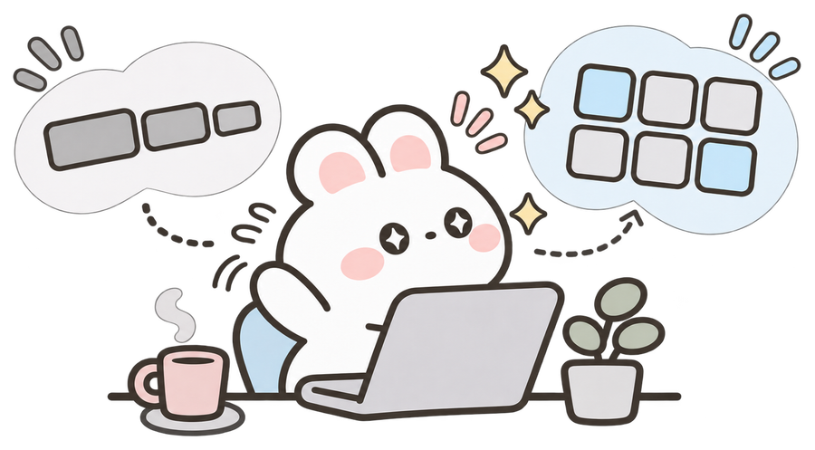

<figure class="heroImg" data-no-zoom>

</figure>

你好，我是 Fanggg 👋

一個看到設計稿，腦中會先跑出 `display: flex` 的前端人

每學會一個新寫法，就少一次跟螢幕寬度吵架

這幾年迷上網頁動畫，因為網頁好看還不夠，要會動才有靈魂

最近開始試著用 grid 切版，有種發現新大陸的感覺

回頭一看，才知道以前的自己在 flex 裡繞了多少遠路

現在腦中先跑出來的，已經悄悄換成 `display: grid` 了（flex 抱歉）

<figure class="Img" data-no-zoom>

</figure>

這裡會記錄我在開發中學到的新招、踩過的坑，希望剛好對你也有幫助

---

## 🤖 從寫程式的人，變成審核官

以前的工作模式很單純：自己寫程式，寫到卡住就打開 Google 開始爬文

分頁一個一個開，從十年前的討論串翻到上個月的部落格，十個解法裡總有一個會動（大概）

近年來工作方式整個翻轉，我把腦袋裡的想法丟給 AI，讓它先寫出第一版，我負責看、挑毛病、退回重寫

講好聽一點叫「審核官」，講白一點，就是一個很會說「這裡不對，再改一次」的人 😌

不過審核官也沒有想像中輕鬆，AI 寫得又快又有自信，寫錯的時候也一樣有自信，所以每一行我還是要看懂才放行

<figure class="Img" data-no-zoom>

</figure>

AI 對我最大的衝擊，曾經一個綁定捲軸的視差逐幀動畫

以前的我，光是研究捲動距離怎麼對到每一幀、畫面怎麼播得順，就要花上好幾天

現在只要動動嘴說一句，AI 10 分鐘就處理好了

那一刻我盯著螢幕，心情很複雜：一半是「哇也太強」，一半是「那我以前那幾天到底在幹嘛」🫠

除了寫程式，我也開始把那些做到很煩、冗長又瑣碎的重複事情，請 AI 幫我做成自動化工具：

- **上線前的檢查**：  
  以前要一個一個設定檔翻，現在交給 agent 跑一輪，我只要看報告
- **每天的工作日誌**：  
  依當天的 commit 自動整理好，下班前不用再努力回想「我今天到底做了什麼」
- **commit 訊息**：  
  格式固定、內容清楚，再也不會出現「fix」「update」「改一下」這種留給未來自己猜謎的訊息
- **寫成 skill**：  
  新專案的預設樣式、SCSS 的寫法慣例，寫成 AI 看得懂的說明書，交代一次就好，不用每次重講。  
  以前是我在背這些規則，現在換 AI 背，我只負責在它忘記的時候提醒它（對，它偶爾也會忘記）

省下來的時間，就拿去研究新的切版寫法，或是⋯⋯多追一集劇 📺

---

## 🧰 技能

前端

HTMLSCSSJavaScriptjQueryGSAP

後端

PHPLaravel

設計

Figma

工具

GitGitHubClaude CodeChatGPT

---

## 🎧 工作以外

下班之後，我的時間大概都被這幾件事瓜分了：

- **KPOP**：  
  歌單裡循環的都是 MAMAMOO、BTOB、PENTAGON，演唱會多半是我的充電休息站。  
  偶爾也會做應援設計，工作上沒機會碰設計，那就拿來做應援吧，反正偶像不會退稿 😌
- **追劇**：  
  韓劇、陸劇都看，美劇則是漫威系列追最多
- **漫威**：  
  忠實漫威迷，片尾彩蛋一定乖乖坐到最後一秒才離場

<figure class="Img" data-no-zoom>

</figure>

所以如果哪天文章更新得特別慢，大概是在追劇，或是在搶演唱會門票 🎫

最高紀錄是連續一個月，每個禮拜都在搶票，幫自己搶，也順便幫朋友搶（雖然不是每次都搶得到 😂）

---

## 🛠️ 關於本站

本站使用 [Astro](https://astro.build/) 建置，版面與配色是我自己在 Figma 設計後實作的，並透過 GitHub Actions 自動部署到 GitHub Pages

文章插圖統一使用黑白灰的極簡風格，流程圖多半用 SVG 繪製

這裡寫的東西大概分成四類：

前端開發

切版、CSS、JavaScript、網頁動畫，各種讓網頁更好看、更好用的寫法

後端開發

PHP、Laravel，以及專案開發中遇到的大小問題

AI 工具

AI 協作、自動化工具，還有各種讓工作更省力的嘗試

隨筆

開發以外的心得、生活紀錄與碎碎念

基本上就是學到什麼寫什麼，踩到坑就再多寫一篇

---

## 🐰 本站的吉祥物

因為我喜歡兔子，所以請 ChatGPT 幫我做了一隻，取名叫「方吉」，剛好拿來當部落格的吉祥物

文章插圖裡出現的白色小兔子就是牠

方吉的個性呆萌又安靜，對什麼都很好奇，看到新東西會認真研究半天，研究到一半又常常一臉困惑

偶爾還會冒出一點天然呆，例如拿著放大鏡找了半天，才發現要找的東西就在自己手上

<figure class="Img" data-no-zoom>

</figure>

