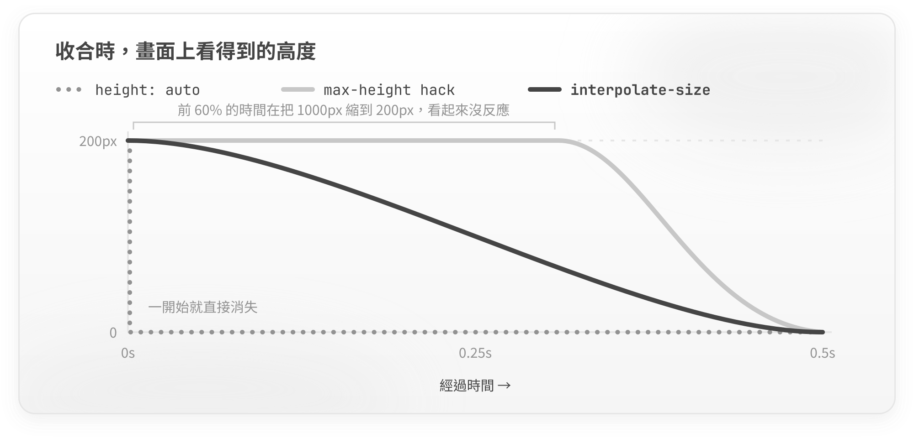
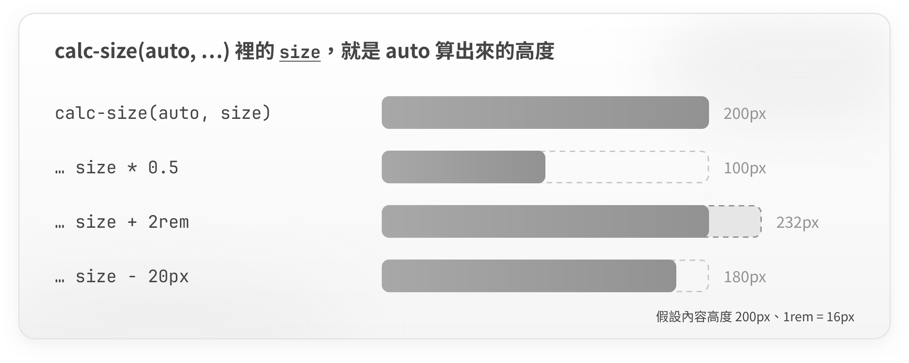

## 🔍 前言

做手風琴、下拉選單的時候，一定遇過這個問題：**`height: 0` 到 `height: auto` 沒有動畫，直接跳過去** 😩

以前只能用 JavaScript 算出實際高度，或是用 `max-height` 猜一個夠大的值來硬做

現在 CSS 有了兩個新工具：

| 工具 | 負責什麼 |
| --- | --- |
| `interpolate-size` | 讓 `auto` 這類關鍵字**可以做動畫** |
| `calc-size()` | 讓 `auto` 這類關鍵字**可以做運算**，例如「auto 的一半」 |

> [!TIP]
> 文中的 CodePen 範例都可以直接操作，點右上角「Edit on CodePen」還能開到 CodePen 修改

---

## 🤔 為什麼需要它？

### 過去的痛點

`auto`、`min-content`、`max-content`、`fit-content` 這些 **內在尺寸（intrinsic size）** 關鍵字，瀏覽器不知道怎麼在它們和數值之間插值，所以過渡會直接跳變：

```css del={8}
.panel {
  height: 0;
  overflow: hidden;
  transition: height 0.3s ease;
}

.panel.open {
  height: auto; /* auto 無法被插值，直接跳過去 */
}
```

### 傳統解法：max-height hack

```css {8}
.panel {
  max-height: 0;
  overflow: hidden;
  transition: max-height 0.5s ease;
}

.panel.open {
  max-height: 1000px; /* 猜一個「應該夠大」的值 */
}
```

看起來有動畫了，但問題是 **動畫是在跑 `0 → 1000px`，不是 `0 → 實際高度`**

假設內容只有 200px，收合時的狀況會是這樣：



- 😐 要預估最大高度，猜太小內容會被切掉
- 😐 動畫時間跟實際內容不成比例
- 😐 收合時前段會「卡住」，看起來像沒反應

### 實際比較看看

按下按鈕，三個面板會同時展開、收合，注意 **收合時中間那個的延遲** 👇

:::codepen{title="三種展開方式比較" height="420"}
```html
<button id="toggle">展開 / 收合</button>
<p class="unsupported">⚠️ 你的瀏覽器還不支援 interpolate-size，右邊會跟左邊一樣直接跳變</p>
<div class="grid" id="grid">
  <section>
    <h3>height: auto</h3>
    <div class="panel jump">
      <p>直接跳變，沒有動畫。</p>
      <p>瀏覽器不知道怎麼從 0 過渡到 auto。</p>
      <p>第三行內容。</p>
    </div>
  </section>
  <section>
    <h3>max-height hack</h3>
    <div class="panel hack">
      <p>max-height 設成 1000px。</p>
      <p>收合時會先停頓一下才動。</p>
      <p>第三行內容。</p>
    </div>
  </section>
  <section>
    <h3>interpolate-size</h3>
    <div class="panel smooth">
      <p>平滑過渡到實際高度。</p>
      <p>展開、收合速度都一致。</p>
      <p>第三行內容。</p>
    </div>
  </section>
</div>
```
```css
body {
  font-family: system-ui, sans-serif;
  padding: 1rem;
  color: #454545;
  background: #f5f5f5;
}

button {
  padding: 0.5rem 1.2rem;
  border: 0;
  border-radius: 999px;
  background: #454545;
  color: #fff;
  font-size: 1rem;
  font-weight: 700;
  cursor: pointer;
}

.grid {
  display: grid;
  grid-template-columns: repeat(3, 1fr);
  gap: 1rem;
  margin-top: 1rem;
}

h3 {
  margin: 0 0 0.5rem;
  font-size: 0.95rem;
  font-family: monospace;
}

.panel {
  overflow: hidden;
  border-radius: 8px;
  background: #fff;
}

.panel p {
  margin: 0;
  padding: 0.5rem 0.75rem;
}

/* 1. 直接跳變 */
.jump {
  height: 0;
  transition: height 0.5s ease;
}
.open .jump {
  height: auto;
}

/* 2. max-height hack */
.hack {
  max-height: 0;
  transition: max-height 0.5s ease;
}
.open .hack {
  max-height: 1000px;
}

/* 3. interpolate-size */
.smooth {
  interpolate-size: allow-keywords;
  height: 0;
  transition: height 0.5s ease;
}
.open .smooth {
  height: auto;
}

.unsupported {
  display: none;
  color: #454545;
  font-weight: 700;
}

@supports not (interpolate-size: allow-keywords) {
  .unsupported {
    display: block;
  }
}
```
```js
document.getElementById("toggle").addEventListener("click", () => {
  document.getElementById("grid").classList.toggle("open");
});
```
:::

---

## 🧩 什麼是 `interpolate-size`？

`interpolate-size` 是一個 CSS 屬性，用來 **開啟內在尺寸關鍵字的插值能力**，讓瀏覽器可以在固定長度和 `auto` 之間平滑過渡

```css
interpolate-size: allow-keywords | numeric-only;
```

| 值 | 說明 |
| --- | --- |
| `numeric-only` | **預設值**。只有數值之間可以插值，`auto` 等關鍵字不能做動畫 |
| `allow-keywords` | `auto`、`min-content`、`max-content`、`fit-content` 也能做動畫 |

### 全域啟用（推薦）

設在 `:root` 上，整個頁面都能用：

```css
:root {
  interpolate-size: allow-keywords;
}
```

> [!NOTE]
> `interpolate-size` 是**可繼承的**，所以設在 `:root` 上，所有子元素都會生效

### 局部啟用

只想讓特定元件生效，就設在那個容器上：

```css
.accordion {
  interpolate-size: allow-keywords;
}
```

---

## 🎬 實際範例

### 範例一：手風琴展開／收合

上面比較範例裡的第三個面板就是這個寫法，重點只有標起來的三行：

```css {2,8,12}
:root {
  interpolate-size: allow-keywords;
}

.accordion-content {
  height: 0;
  overflow: hidden;
  transition: height 0.35s ease;
}

.accordion-content.open {
  height: auto;
}
```

完全不用 JavaScript 算高度，也不用 `max-height` hack ✨

### 範例二：hover 展開的圖示按鈕

平常只露出圖示，滑過去才展開文字。收合時用固定寬度，展開時用 `max-content`：

```css {7,14}
:root {
  interpolate-size: allow-keywords;
}

.icon-btn {
  display: inline-flex;
  width: 2.75rem;
  overflow: hidden;
  white-space: nowrap;
  transition: width 0.3s ease;
}

.icon-btn:hover {
  width: max-content;
}
```

> [!WARNING]
> 不要把收合狀態寫成 `width: min-content`：加了 `white-space: nowrap` 之後文字不會換行，`min-content` 和 `max-content` 會一樣寬，就沒有動畫了

:::codepen{title="hover 展開的圖示按鈕" height="300"}
```html
<div class="toolbar">
  <button class="icon-btn"><span class="icon">✏️</span><span class="label">編輯文章</span></button>
  <button class="icon-btn"><span class="icon">📤</span><span class="label">分享到社群</span></button>
  <button class="icon-btn"><span class="icon">🗑️</span><span class="label">移到垃圾桶</span></button>
</div>
<p class="hint">滑鼠移到按鈕上 👆</p>
```
```css
:root {
  interpolate-size: allow-keywords;
}

body {
  font-family: system-ui, sans-serif;
  padding: 2rem;
  color: #454545;
  background: #f5f5f5;
}

.toolbar {
  display: flex;
  gap: 0.75rem;
}

.icon-btn {
  display: inline-flex;
  align-items: center;
  gap: 0.5rem;
  width: 2.75rem;
  height: 2.75rem;
  padding: 0 0.7rem;
  overflow: hidden;
  white-space: nowrap;
  border: 1px solid #c7c7c7;
  border-radius: 999px;
  background: #fff;
  color: #454545;
  font-size: 1rem;
  cursor: pointer;
  transition: width 0.3s ease;
}

.icon-btn:hover {
  width: max-content;
  background: #e6e6e6;
}

.icon {
  flex-shrink: 0;
  filter: grayscale(1);
}

.hint {
  color: #929292;
}
```
:::

### 範例三：搭配 `@keyframes` 動畫

`interpolate-size` 對 `@keyframes` 一樣有效，適合做「出現時展開」的效果：

```css
:root {
  interpolate-size: allow-keywords;
}

.reveal {
  overflow: hidden;
  animation: reveal 0.5s ease forwards;
}

@keyframes reveal {
  from {
    height: 0;
    opacity: 0;
  }
  to {
    height: auto;
    opacity: 1;
  }
}
```

---

## 🧮 深入 `calc-size()` 函式

### 為什麼需要 `calc-size()`？

`calc()` 不能拿 `auto`、`min-content` 這類關鍵字來運算：

```css
/* ❌ 這是無效的 */
width: calc(auto + 20px);
height: calc(min-content * 0.8);
```

`calc-size()` 就是為了這個限制而生，讓你可以 **對內在尺寸做數學運算**

### 語法

```css
calc-size(<basis>, <calculation>)
```

| 參數 | 說明 |
| --- | --- |
| `<basis>` | 基礎尺寸。可以是 `auto`、`min-content`、`max-content`、`fit-content`、`stretch`，或另一個 `calc-size()`，也可以是 `100px` 這種長度 |
| `<calculation>` | 運算式。用特殊關鍵字 **`size`** 代表 `<basis>` 算出來的結果，再拿來加減乘除 |

一張圖看懂 `size` 是什麼：



```css
/* size 代表 basis 的計算結果 */
height: calc-size(auto, size);            /* 等同於 auto */
height: calc-size(auto, size * 0.5);      /* auto 高度的一半 */
height: calc-size(auto, size - 20px);     /* auto 高度減去 20px */
height: calc-size(auto, size + 2rem);     /* auto 高度加上 2rem */

width: calc-size(min-content, size);        /* 等同於 min-content */
width: calc-size(max-content, size * 0.8);  /* max-content 的 80% */
width: calc-size(fit-content, size + 4rem); /* fit-content 再加 4rem */
```

### `calc-size()` vs `calc()`

| 特性 | `calc()` | `calc-size()` |
| --- | --- | --- |
| 數值間運算 | ✅ `calc(100px + 2rem)` | ✅ `calc-size(100px, size + 2rem)` |
| 對 `auto` 運算 | ❌ | ✅ `calc-size(auto, size * 0.5)` |
| 對 `min-content` 運算 | ❌ | ✅ `calc-size(min-content, size + 10px)` |
| 巢狀運算 | ✅ | ✅ calculation 裡可以再放 `calc()` |
| 動畫插值 | 僅數值 | ✅ 可以和數值互相過渡 |

### 實用範例

#### 側邊欄展開動畫

收合時只露出圖示，展開時是「內容寬度再多 2rem 呼吸空間」：

```css {8}
.sidebar {
  width: 60px;
  overflow: hidden;
  transition: width 0.4s ease;
}

.sidebar.expanded {
  width: calc-size(fit-content, size + 2rem);
}
```

:::codepen{title="calc-size 側邊欄" height="360"}
```html
<aside class="sidebar" id="sidebar">
  <button class="toggle" id="toggle">☰</button>
  <a href="#"><span>🏠</span>首頁</a>
  <a href="#"><span>📝</span>文章列表</a>
  <a href="#"><span>🏷️</span>標籤</a>
  <a href="#"><span>⚙️</span>網站設定</a>
</aside>
<main>點左上角 ☰ 展開側邊欄</main>
```
```css
:root {
  interpolate-size: allow-keywords;
}

body {
  display: flex;
  height: 100vh;
  margin: 0;
  font-family: system-ui, sans-serif;
  color: #454545;
}

.sidebar {
  display: flex;
  flex-direction: column;
  gap: 0.25rem;
  width: 60px;
  padding: 0.5rem;
  overflow: hidden;
  white-space: nowrap;
  background: #454545;
  box-sizing: border-box;
  transition: width 0.4s ease;
}

.sidebar.expanded {
  /* fit-content 的寬度再加 2rem */
  width: calc-size(fit-content, size + 2rem);
}

.sidebar a,
.toggle {
  display: flex;
  align-items: center;
  gap: 0.75rem;
  padding: 0.6rem 0.5rem;
  border: 0;
  border-radius: 8px;
  background: none;
  color: #f5f5f5;
  font-size: 1rem;
  text-decoration: none;
  cursor: pointer;
}

.sidebar a:hover,
.toggle:hover {
  background: rgba(255, 255, 255, 0.12);
}

.sidebar a span {
  filter: grayscale(1);
}

main {
  flex: 1;
  padding: 1.5rem;
  background: #f5f5f5;
}
```
```js
document.getElementById("toggle").addEventListener("click", () => {
  document.getElementById("sidebar").classList.toggle("expanded");
});
```
:::

#### 只顯示內容的一半

做「閱讀更多」的預覽很好用：

```css
.preview {
  height: calc-size(auto, size * 0.5);
  overflow: hidden;
}
```

#### 留出固定空間

```css
.main-content {
  height: calc-size(auto, size - 80px);
  /* 內容高度扣掉 80px */
}
```

#### 搭配 `@keyframes` 動畫

```css
@keyframes grow-in {
  from {
    height: 0;
  }
  to {
    height: calc-size(auto, size + 1rem);
    /* 最終高度 = auto + 1rem 的額外空間 */
  }
}

.card {
  animation: grow-in 0.4s ease forwards;
  overflow: hidden;
}
```

#### 響應式縮放

```css
.container {
  /* 小螢幕只顯示 auto 高度的 70% */
  height: calc-size(auto, size * 0.7);
}

@media (min-width: 768px) {
  .container {
    height: calc-size(auto, size); /* 完整高度 */
  }
}
```

### 在 `calc-size()` 裡使用 `calc()`

`<calculation>` 的部分可以再放 `calc()`、`min()`、`max()`、`clamp()`：

```css
width: calc-size(auto, size - calc(2rem + 10px));
height: calc-size(fit-content, size * calc(1 / 3));
width: calc-size(max-content, max(size, 200px));
width: calc-size(auto, clamp(100px, size, 500px));
```

### 什麼時候用哪一個？

| 想做的事 | 寫法 |
| --- | --- |
| 從 `0` 過渡到 `auto` | 只需要 `interpolate-size: allow-keywords` |
| 從 `min-content` 過渡到 `max-content` | 只需要 `interpolate-size: allow-keywords` |
| `auto` 的一半高度 | `calc-size(auto, size * 0.5)` |
| `fit-content` 加上額外間距 | `calc-size(fit-content, size + 2rem)` |
| `auto` 但不超過某個值 | `calc-size(auto, min(size, 500px))` |

> [!TIP]
> **簡單記法**：目標就是內在尺寸本身 → `interpolate-size`；要對內在尺寸「加工」→ `calc-size()`

> [!IMPORTANT]
>
> - `size` 關鍵字 **只能在 `calc-size()` 裡用**，`calc()` 裡不能用
> - `calc-size()` 的結果 **不能再當 `calc()` 的運算元**，但可以當另一個 `calc-size()` 的 basis
> - 只是要設定靜態尺寸的話，**不需要** `interpolate-size` 也能用 `calc-size()`

---

## 📂 搭配 `<details>` 元素

原生的 `<details>` / `<summary>` 也能做展開動畫，但要注意：**收合時內容根本不會渲染**，直接對 `details` 設 `height` 是沒有動畫的

要改用 `::details-content` 偽元素，它就是包住 `<summary>` 以外內容的那一層：

```css {6,10,14}
details {
  interpolate-size: allow-keywords;
}

details::details-content {
  block-size: 0;
  overflow: hidden;
  transition:
    block-size 0.4s ease,
    content-visibility 0.4s allow-discrete;
}

details[open]::details-content {
  block-size: auto;
}
```

> [!NOTE]
> `content-visibility` 要加上 `allow-discrete`：收合時內容會被設成隱藏，這行讓它等動畫跑完才隱藏，不然收合會直接跳掉

:::codepen{title="details 展開動畫" height="380"}
```html
<details>
  <summary>interpolate-size 是什麼？</summary>
  <p>讓 auto、min-content 這類內在尺寸關鍵字可以做動畫的 CSS 屬性。</p>
</details>
<details>
  <summary>calc-size() 是什麼？</summary>
  <p>可以對內在尺寸做運算的函式，用 size 關鍵字代表基礎值。</p>
  <p>例如 calc-size(auto, size * 0.5) 就是 auto 高度的一半。</p>
</details>
<details>
  <summary>不支援的瀏覽器會怎樣？</summary>
  <p>一樣可以展開收合，只是沒有動畫，屬於天然的漸進增強。</p>
</details>
```
```css
details {
  interpolate-size: allow-keywords;
  margin-bottom: 0.75rem;
  border: 1px solid #e6e6e6;
  border-radius: 10px;
  background: #fff;
}

details::details-content {
  block-size: 0;
  overflow: hidden;
  transition:
    block-size 0.4s ease,
    content-visibility 0.4s allow-discrete;
}

details[open]::details-content {
  block-size: auto;
}

summary {
  padding: 0.75rem 1rem;
  font-weight: 700;
  cursor: pointer;
}

details p {
  margin: 0;
  padding: 0 1rem 0.75rem;
}

body {
  font-family: system-ui, sans-serif;
  padding: 1.5rem;
  color: #454545;
  background: #f5f5f5;
}
```
:::

> [!WARNING]
> `::details-content` 是比較新的偽元素，目前 Chromium 系瀏覽器支援度最好，其他瀏覽器請先到 [Can I Use](https://caniuse.com/mdn-css_selectors_details-content) 確認

---

## ⚠️ 注意事項

**1. 要搭配 `overflow: hidden`**

從 `height: 0` 過渡到 `height: auto` 時，要設定 `overflow: hidden` 或 `overflow: clip`，不然內容會直接溢出來

**2. 可以繼承**

`interpolate-size` 是可繼承的屬性，設在父層，所有子元素都會生效。建議直接設在 `:root`

**3. 不影響最終版面**

`interpolate-size` 只影響 **動畫過程的插值**，不會改變元素最後算出來的尺寸

**4. 只影響內在尺寸關鍵字**

會受影響的只有這些關鍵字：

- `auto`
- `min-content`
- `max-content`
- `fit-content`
- `stretch`（部分瀏覽器）
- `contain`（部分瀏覽器）

一般數值之間的過渡本來就能動，不受這個屬性影響

---

## 🌐 瀏覽器支援

`interpolate-size` 和 `calc-size()` 目前只有 Chromium 系瀏覽器支援：

| 瀏覽器 | 支援狀況 |
| --- | --- |
| Chrome | ✅ 129+ |
| Edge | ✅ 129+ |
| Firefox | ❌ 尚未支援 |
| Safari | ❌ 尚未支援 |

> [!NOTE]
> 支援狀況變化很快，使用前請到 [Can I Use](https://caniuse.com/mdn-css_properties_interpolate-size) 確認最新狀態

### 漸進增強

不支援的瀏覽器會直接忽略這個屬性，元素一樣能展開收合，**只是沒有動畫** 👍

```css
/* 不支援的瀏覽器會忽略，退回原本的跳變行為 */
:root {
  interpolate-size: allow-keywords;
}

/* 需要針對支援的瀏覽器加樣式時，用功能偵測 */
@supports (interpolate-size: allow-keywords) {
  .panel {
    transition: height 0.3s ease;
  }
}
```

---

## ⚖️ 跟舊方案比較

| 方案 | 優點 | 缺點 |
| --- | --- | --- |
| `max-height` hack | 相容性好 | 動畫時間不準、要猜數值 |
| JavaScript 計算 | 精確 | 要監聽內容變化、有效能成本 |
| `interpolate-size` | 原生、精確、零 JS | 目前只有 Chromium 支援 |

---

## 🏆 總結

**`interpolate-size: allow-keywords`**

- 一行 CSS 就能讓 `height: auto` 做過渡動畫
- 可以繼承，設在 `:root` 全域生效
- 天然的漸進增強，不支援的瀏覽器也不會壞

**`calc-size()`**

- 突破 `calc()` 不能對內在尺寸運算的限制
- 用 `size` 關鍵字代表基礎值，自由加減乘除
- 搭配 `interpolate-size` 做出更細緻的尺寸動畫

新專案建議直接加上這段，從此告別 `max-height` hack 🎉

```css
:root {
  interpolate-size: allow-keywords;
}
```
