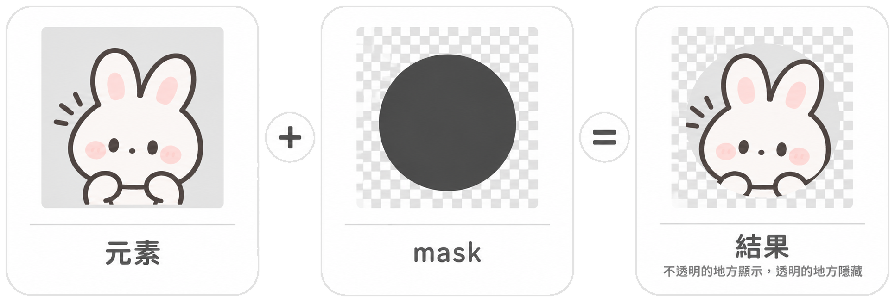
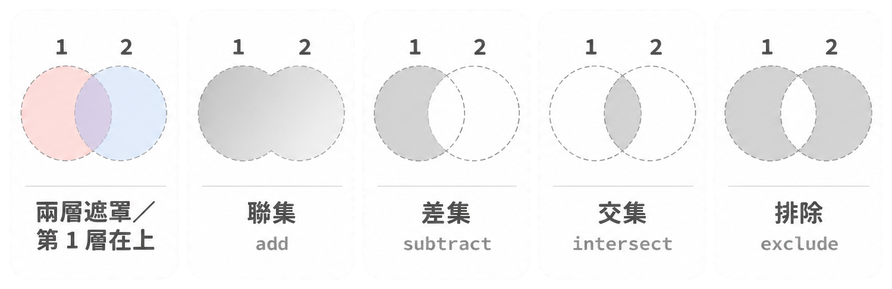
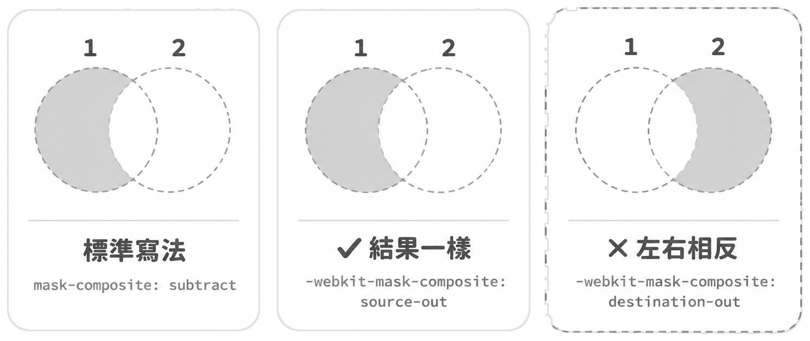
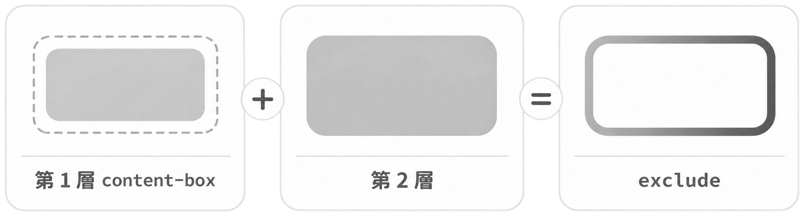

## 🔍 前言

`mask-composite` 是 CSS 的 **遮罩合成屬性**，用來決定一個元素設定了 **多層 mask** 時，各層之間要怎麼合成

換個合成方式，同樣兩個圓就能做出 **聯集、差集、交集、排除** 四種形狀 ✨

---

## 🎭 先複習一下 mask

`mask` 是拿一張圖（或漸層）蓋在元素上，**不透明的地方顯示、透明的地方隱藏**



```css
.shape {
  /* 黑色（不透明）的圓形範圍顯示，外面透明的地方隱藏 */
  mask: radial-gradient(circle at 35% 50%, #000 38%, transparent 39%);
}
```

用逗號隔開就能放 **多層**，跟 `background` 一樣，**寫在前面的在上面**：

```css
.shape {
  mask:
    radial-gradient(circle at 35% 50%, #000 38%, transparent 39%), /* 第 1 層：左邊的圓 */
    radial-gradient(circle at 65% 50%, #000 38%, transparent 39%); /* 第 2 層：右邊的圓 */
}
```

這時候兩層要怎麼疊在一起，就是 `mask-composite` 決定的 👇

---

## 🧩 四種合成方式



| 效果 | `mask-composite`（標準） | `-webkit-mask-composite`（WebKit） | 說明 |
| --- | --- | --- | --- |
| 聯集 | `add` | `source-over` | 兩層都顯示，**預設值** |
| 差集 | `subtract` | `source-out` | 第 1 層減掉第 2 層，被第 2 層蓋到的地方變透明 |
| 交集 | `intersect` | `source-in` | 只顯示兩層重疊的地方 |
| 排除 | `exclude` | `xor` | 兩層都顯示，但重疊的地方變透明 |

> [!NOTE]
> 沒有設定 `mask-composite` 時，預設值就是 `add`，所以效果跟聯集一樣

### 差集會看順序

聯集、交集、排除不管哪層在上面，結果都一樣

只有 **差集** 是「上面那層減掉下面那層」，兩層順序對調，留下來的就變成另一邊的圓 🔄

### 自己切換看看

選不同的合成方式，或勾選「交換兩層順序」，看看差集的變化 👇

:::codepen{title="mask-composite 合成方式" height="520"}
```html
<div class="controls">
  <label><input type="radio" name="mode" value="add"> 聯集 add</label>
  <label><input type="radio" name="mode" value="subtract" checked> 差集 subtract</label>
  <label><input type="radio" name="mode" value="intersect"> 交集 intersect</label>
  <label><input type="radio" name="mode" value="exclude"> 排除 exclude</label>
  <label class="swap"><input type="checkbox" id="swap"> 交換兩層順序</label>
</div>

<div class="stage">
  <div class="shape" id="shape"></div>
  <!-- 虛線是兩個圓原本的位置 -->
  <svg viewBox="0 0 100 100">
    <circle cx="35" cy="50" r="31.16" />
    <circle cx="65" cy="50" r="31.16" />
    <text id="labelLeft" x="20" y="10">1</text>
    <text id="labelRight" x="80" y="10">2</text>
  </svg>
</div>

<pre id="code"></pre>
```
```css
body {
  padding: 1.25rem;
  font-family: system-ui, sans-serif;
  color: #454545;
  background: #f5f5f5;
  accent-color: #454545;
}

.controls {
  display: flex;
  flex-wrap: wrap;
  gap: 0.5rem 1.25rem;
  margin-bottom: 1rem;
}

.controls label {
  cursor: pointer;
}

.swap {
  font-weight: 700;
}

.stage {
  position: relative;
  width: 220px;
  aspect-ratio: 1;
  margin: 0 auto;
}

.shape {
  position: absolute;
  inset: 0;
  background: linear-gradient(90deg, #454545, #c7c7c7);
}

.stage svg {
  position: absolute;
  inset: 0;
  overflow: visible;
}

.stage circle {
  fill: none;
  stroke: #454545;
  stroke-width: 0.8;
  stroke-dasharray: 3 2.5;
  opacity: 0.5;
}

.stage text {
  font: 700 8px monospace;
  text-anchor: middle;
}

pre {
  margin: 1rem 0 0;
  padding: 0.75rem 1rem;
  border-radius: 10px;
  background: #454545;
  color: #f5f5f5;
  font-size: 0.8rem;
  white-space: pre-wrap;
}
```
```js
const shape = document.getElementById("shape");
const swap = document.getElementById("swap");
const code = document.getElementById("code");

const LEFT = "radial-gradient(circle at 35% 50%, #000 38%, transparent 39%)";
const RIGHT = "radial-gradient(circle at 65% 50%, #000 38%, transparent 39%)";
const WEBKIT = { add: "source-over", subtract: "source-out", intersect: "source-in", exclude: "xor" };

function render() {
  const mode = document.querySelector("input[name=mode]:checked").value;
  const layers = swap.checked ? [RIGHT, LEFT] : [LEFT, RIGHT];

  // mask 簡寫會把 mask-composite 重設成 add，所以要先設 mask 再設 mask-composite
  shape.style.mask = layers.join(", ");
  shape.style.maskComposite = mode;

  // 虛線上的 1、2 標示跟著順序對調
  document.getElementById("labelLeft").textContent = swap.checked ? "2" : "1";
  document.getElementById("labelRight").textContent = swap.checked ? "1" : "2";

  code.textContent =
    `mask:\n  ${layers[0]}, /* 第 1 層 */\n  ${layers[1]}; /* 第 2 層 */\n` +
    `mask-composite: ${mode};\n-webkit-mask-composite: ${WEBKIT[mode]};`;
}

document.querySelectorAll("input").forEach((input) => input.addEventListener("change", render));
render();
```
:::

---

## 💻 語法

```css
.shape {
  /* 舊版 Chrome、Safari 用 */
  -webkit-mask:
    radial-gradient(circle at 35% 50%, #000 38%, transparent 39%),
    radial-gradient(circle at 65% 50%, #000 38%, transparent 39%);
  -webkit-mask-composite: xor;

  /* 標準寫法 */
  mask:
    radial-gradient(circle at 35% 50%, #000 38%, transparent 39%),
    radial-gradient(circle at 65% 50%, #000 38%, transparent 39%);
  mask-composite: exclude;
}
```

三層以上時，`mask-composite` 也可以用逗號寫 **多個值**，第 1 個值對應第 1 層、第 2 個值對應第 2 層，以此類推

每個值決定「這一層」要怎麼跟「下面那些層合成好的結果」合成，所以最下面那層的值不會用到

---

## ⚠️ 要注意的地方

### 1. WebKit 的差集是 `source-out`，不是 `destination-out`



WebKit 的值是用 **source（上面那層）** 和 **destination（下面那層）** 來描述：

| WebKit 值 | 意思 | 對應標準值 |
| --- | --- | --- |
| `source-out` | 上面那層，扣掉被下面那層蓋到的地方 | `subtract` ✅ |
| `destination-out` | 下面那層，扣掉被上面那層蓋到的地方 | 順序相反的 `subtract` ❌ |
| `source-in` | 上面那層，只留跟下面那層重疊的地方 | `intersect` ✅ |

> [!WARNING]
> 寫成 `destination-out` 在新版瀏覽器看不出問題，因為標準寫法寫在後面會蓋過去
> 
> 但在只認得 WebKit 寫法的舊版瀏覽器，差集的結果會 **左右相反**

### 2. `mask-composite` 要寫在 `mask` 後面

`mask` 是簡寫屬性，會把沒寫到的子屬性重設回預設值，**`mask-composite` 也包含在內**

```css del={2} ins={8}
.shape {
  mask-composite: exclude; /* ❌ 被下一行的 mask 重設回 add */
  mask: radial-gradient(...), radial-gradient(...);
}

.shape {
  mask: radial-gradient(...), radial-gradient(...);
  mask-composite: exclude; /* ✅ */
}
```

`-webkit-mask` 跟 `-webkit-mask-composite` 也是一樣的道理

### 3. 舊版 Chrome 要搭配 `-webkit-mask`

Chrome 120 以前只認得 `-webkit-` 開頭的 mask 屬性，只寫 `-webkit-mask-composite` 但沒寫 `-webkit-mask` 是沒有作用的

要支援舊版瀏覽器，就像上面的語法一樣 **兩組都寫**，先寫 `-webkit-` 再寫標準寫法

---

## 🌐 瀏覽器支援

| 寫法 | 支援 |
| --- | --- |
| `mask-composite` | Chrome / Edge 120+、Firefox 53+、Safari 15.4+ |
| `-webkit-mask-composite` | 舊版 Chrome、Safari |

> [!NOTE]
> 支援狀況可以到 [Can I Use](https://caniuse.com/mdn-css_properties_mask-composite) 確認

---

## 🛠️ 實用範例：漸層邊框

`border-image` 可以做漸層邊框，但 **跟 `border-radius` 一起用時圓角會失效**

這時候就輪到 `mask-composite` 出場，做法是在偽元素上放漸層，再用兩層遮罩把中間挖空：

| 層 | 寫法 | 範圍 |
| --- | --- | --- |
| 第 1 層 | `linear-gradient(#000 0 0) content-box` | 只蓋內容區（不含 padding） |
| 第 2 層 | `linear-gradient(#000 0 0)` | 蓋滿整個元素 |

兩層用 **排除** 合成，重疊的內容區變透明，只剩下 padding 那一圈，`padding` 的大小就是邊框粗細



實際效果 👇

:::codepen{title="mask-composite 漸層邊框" height="300"}
```html
<div class="card">
  <h3>漸層邊框</h3>
  <p>用 mask-composite 把中間挖空，圓角也正常</p>
</div>

<div class="card spin">
  <h3>旋轉漸層邊框</h3>
  <p>搭配 @property 讓漸層角度動起來</p>
</div>
```
```css
body {
  display: grid;
  grid-template-columns: repeat(auto-fit, minmax(220px, 1fr));
  gap: 1.5rem;
  padding: 1.5rem;
  font-family: system-ui, sans-serif;
  color: #454545;
  background: #f5f5f5;
}

.card {
  position: relative;
  padding: 1.5rem;
  border-radius: 20px;
  background: #fff;
}

.card h3 {
  margin: 0 0 0.5rem;
}

.card p {
  margin: 0;
  color: #929292;
}

/* 漸層邊框 */
.card::before {
  content: "";
  position: absolute;
  inset: 0;
  padding: 4px; /* 邊框粗細 */
  border-radius: inherit;
  background: linear-gradient(135deg, #454545, #e6e6e6);
  pointer-events: none;

  -webkit-mask:
    linear-gradient(#000 0 0) content-box,
    linear-gradient(#000 0 0);
  -webkit-mask-composite: xor;
  mask:
    linear-gradient(#000 0 0) content-box,
    linear-gradient(#000 0 0);
  mask-composite: exclude;
}

/* 旋轉版：用 @property 讓角度可以做動畫 */
@property --angle {
  syntax: "<angle>";
  inherits: false;
  initial-value: 0deg;
}

.spin::before {
  background: conic-gradient(from var(--angle), #454545, #c7c7c7, #e6e6e6, #929292, #454545);
  animation: spin 3s linear infinite;
}

@keyframes spin {
  to {
    --angle: 360deg;
  }
}
```
:::

> [!TIP]
> 也可以把兩層順序對調，改用差集：`linear-gradient(#000 0 0), linear-gradient(#000 0 0) content-box` 搭配 `mask-composite: subtract`，結果一樣

更多漸層邊框的做法可以參考 [CSS 漸層邊框](https://ibestlibrary.ito.tw/codepen-detail/border-gradient/)

---

## 🏆 結論

- 🎭 `mask` 用逗號可以放多層，寫在前面的在上面
- 🧩 `mask-composite` 有聯集 `add`、差集 `subtract`、交集 `intersect`、排除 `exclude` 四種，預設是 `add`
- 🔄 只有差集會看順序，WebKit 寫法要用 `source-out`
- ⚠️ `mask-composite` 要寫在 `mask` 簡寫後面，不然會被重設

漸層邊框、挖洞、形狀組合這類效果，用 `mask-composite` 都能只靠 CSS 完成 ✨

---

## 📚 參考連結

- [CSS 影像遮罩 mask](https://steam.oxxostudio.tw/category/css/content/mask.html)
- [mask-composite｜MDN](https://developer.mozilla.org/en-US/docs/Web/CSS/mask-composite)
