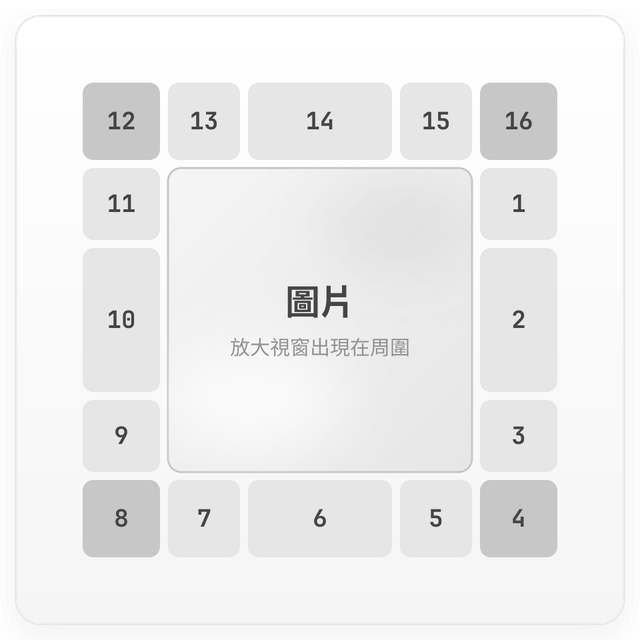

## 🔍 elevatezoom-plus 套件說明

elevatezoom-plus 提供圖片放大、縮放與放大鏡效果，適合用在電商網站或圖片展示頁面

以 jQuery 為基礎，放大方式可以自訂，例如視窗縮放、放大鏡鏡頭縮放、內部縮放

---

## 📦 使用方法

引入 jQuery 與 `jquery.ez-plus.js`：

```html
<script src="jquery.min.js"></script>
<script src="jquery.ez-plus.js"></script>
```

準備兩張圖片：**原圖** 和 **放大用的大圖**（尺寸依放大倍率決定）

大圖的路徑寫在 `data-zoom-image`：

```html
<div class="Img">
  
</div>

<script>
  $(function () {
    $(".Img img").ezPlus({
      zoomType: "window",
      easing: true, // 平滑效果
      zoomWindowFadeIn: 300, // 淡入時間
      zoomWindowFadeOut: 300, // 淡出時間
      zoomWindowOffsetX: 10, // 調整放大視窗 X 軸位置
      zoomWindowOffsetY: 0, // 調整放大視窗 Y 軸位置
      zoomWindowWidth: 300, // 放大視窗寬度
      zoomWindowHeight: 300, // 放大視窗高度
      cursor: "grab",
    });
  });
</script>
```

---

## ⚙️ 參數說明

| 參數名稱 | 預設值 | 功能說明 |
| --- | --- | --- |
| `responsive` | `true` | 響應式設計，適用於可變尺寸的版面 |
| `scrollZoom` | `false` | 滑鼠滾輪縮放 |
| `imageCrossfade` | `false` | 圖片淡入淡出效果 |
| `loadingIcon` | `false` | 設定 loading 圖示的網址 |
| `easing` | `false` | 是否啟用放大視窗的緩動效果 |
| `easingAmount` | `12` | 緩動的程度，數字越大跟隨得越慢 |
| `lensSize` | `200` | 放大鏡的大小（`zoomType` 必須是 `lens` 才有作用） |
| `zoomWindowWidth` | `400` | 放大視窗的寬度 |
| `zoomWindowHeight` | `400` | 放大視窗的高度 |
| `zoomWindowOffsetX` | `0` | 放大視窗 X 軸的偏移量 |
| `zoomWindowOffsetY` | `0` | 放大視窗 Y 軸的偏移量 |
| `zoomWindowPosition` | `1` | 放大視窗的位置，可以填編號（1～16，見下圖）或選擇器 |
| `lensFadeIn` | `false` | 放大鏡淡入時間（毫秒） |
| `lensFadeOut` | `false` | 放大鏡淡出時間（毫秒） |
| `zoomWindowFadeIn` | `false` | 放大視窗淡入時間（毫秒） |
| `zoomWindowFadeOut` | `false` | 放大視窗淡出時間（毫秒） |
| `zoomTintFadeIn` | `false` | 色調淡入時間（毫秒） |
| `zoomTintFadeOut` | `false` | 色調淡出時間（毫秒） |
| `borderSize` | `4` | 放大視窗的邊框大小（px） |
| `showLens` | `true` | 是否顯示放大鏡 |
| `borderColour` | `#888` | 放大視窗的邊框顏色 |
| `lensBorderSize` | `1` | 放大鏡的邊框寬度（px） |
| `lensShape` | `square` | 放大鏡形狀（`square` 或 `round`） |
| `zoomType` | `window` | 放大方式（`window`、`lens`、`inner`） |
| `containLensZoom` | `false` | 限制放大鏡範圍不超出圖片 |
| `lensColour` | `white` | 放大鏡顏色 |
| `lensOpacity` | `0.4` | 放大鏡透明度 |
| `tint` | `false` | 是否啟用色調覆蓋 |
| `tintColour` | `#333` | 色調顏色 |
| `tintOpacity` | `0.4` | 色調透明度 |
| `gallery` | `false` | 設定相簿的 ID，啟用切換放大圖片的功能 |
| `cursor` | `inherit` | 滑鼠游標樣式（`default`、`pointer`、`grab`、`crosshair` 等） |

> [!NOTE]
> 預設值依 ez-plus 1.2.1 的原始碼（`jquery.ez-plus.js`）整理。  
> 淡入淡出的預設值 `false` 代表沒有動畫，填入毫秒數才會啟用

`zoomWindowPosition` 的 16 個位置，預設值 `1` 是圖片右側、上緣對齊：



---

## 🧪 範例

### 1. 三種放大方式

`zoomType` 決定放大的方式：

| `zoomType` | 效果 |
| --- | --- |
| `window` | 在圖片旁邊開一個放大視窗，**預設值** |
| `lens` | 放大鏡直接在圖片上移動，搭配 `lensShape: "round"` 變成圓形鏡頭 |
| `inner` | 整張圖片直接換成放大後的畫面，跟著滑鼠移動 |

切換看看，滑鼠移到圖片上 👇

:::codepen{title="elevatezoom-plus 三種放大方式" height="520" scripts="https://cdn.jsdelivr.net/npm/jquery@3.7.1/dist/jquery.min.js,https://cdn.jsdelivr.net/npm/ez-plus@1.2.1/src/jquery.ez-plus.js"}
```html
<div class="controls">
  <label><input type="radio" name="mode" value="window" checked> 視窗放大 window</label>
  <label><input type="radio" name="mode" value="lens"> 鏡頭放大 lens</label>
  <label><input type="radio" name="mode" value="round"> 圓形鏡頭 lens + round</label>
  <label><input type="radio" name="mode" value="inner"> 內部放大 inner</label>
</div>

<div class="stage">
  
</div>

<pre id="code"></pre>
```
```css
body {
  padding: 1.25rem;
  font-family: system-ui, sans-serif;
  color: #454545;
  background: #f5f5f5;
  accent-color: #454545;
}

.controls {
  display: flex;
  flex-wrap: wrap;
  gap: 0.5rem 1.25rem;
  margin-bottom: 1rem;
}

.controls label {
  cursor: pointer;
}

.stage img {
  display: block;
  width: 260px;
  height: 260px;
  border-radius: 12px;
}

pre {
  margin: 1rem 0 0;
  padding: 0.75rem 1rem;
  border-radius: 10px;
  background: #454545;
  color: #f5f5f5;
  font-size: 0.8rem;
  white-space: pre-wrap;
}
```
```js
const CONFIGS = {
  window: {
    zoomType: "window",
    zoomWindowWidth: 260,
    zoomWindowHeight: 260,
    zoomWindowOffsetX: 16,
    borderSize: 1,
    borderColour: "#c7c7c7",
    easing: true,
  },
  lens: {
    zoomType: "lens",
    lensSize: 140,
  },
  round: {
    zoomType: "lens",
    lensShape: "round",
    lensSize: 140,
  },
  inner: {
    zoomType: "inner",
    cursor: "crosshair",
  },
};

function render() {
  const mode = $("input[name=mode]:checked").val();
  const $photo = $("#photo");

  // 換模式前先移除舊的放大鏡
  // destroy() 不會解除綁在圖片上的事件，要自己 off 掉
  const ez = $photo.data("ezPlus");
  if (ez) {
    ez.destroy();
    $photo.off(".ezpspace").removeData("ezPlus");
  }

  $photo.ezPlus(CONFIGS[mode]);

  const lines = Object.entries(CONFIGS[mode])
    .map(([key, value]) => `  ${key}: ${JSON.stringify(value)},`)
    .join("\n");
  $("#code").text(`$("#photo").ezPlus({\n${lines}\n});`);
}

$("input[name=mode]").on("change", render);
render();
```
:::

 

### 2. 商品頁相簿

商品頁常見「主圖 + 一排縮圖」，點縮圖切換主圖，主圖也要能放大

ez-plus 內建 `gallery` 參數，切換圖片不用自己寫：

1. 縮圖用 `<a>` 包起來，`data-image` 放切換後的主圖、`data-zoom-image` 放對應的大圖
2. 縮圖外層的 `id` 填進 `gallery`
3. `galleryActiveClass` 設定目前縮圖要加的 class，方便寫樣式

```html


<div id="thumbs">
  <a href="#" class="active" data-image="01.jpg" data-zoom-image="01-large.jpg">
    
  </a>
  <a href="#" data-image="02.jpg" data-zoom-image="02-large.jpg">
    
  </a>
</div>
```

```js
$("#main").ezPlus({
  gallery: "thumbs", // 縮圖外層的 id，不用加 #
  galleryActiveClass: "active",
});
```

範例裡還加了「點主圖看大圖」，大圖網址直接讀目前縮圖的 `data-zoom-image` 👇

:::codepen{title="elevatezoom-plus 商品頁相簿" height="440" scripts="https://cdn.jsdelivr.net/npm/jquery@3.7.1/dist/jquery.min.js,https://cdn.jsdelivr.net/npm/ez-plus@1.2.1/src/jquery.ez-plus.js"}
```html
<div class="product">
  

  <div id="thumbs">
    <a href="#" class="active" data-image="https://picsum.photos/id/250/400/400" data-zoom-image="https://picsum.photos/id/250/1200/1200">
      
    </a>
    <a href="#" data-image="https://picsum.photos/id/175/400/400" data-zoom-image="https://picsum.photos/id/175/1200/1200">
      
    </a>
    <a href="#" data-image="https://picsum.photos/id/30/400/400" data-zoom-image="https://picsum.photos/id/30/1200/1200">
      
    </a>
    <a href="#" data-image="https://picsum.photos/id/21/400/400" data-zoom-image="https://picsum.photos/id/21/1200/1200">
      
    </a>
  </div>

  <p class="tip">點縮圖切換，點主圖看大圖</p>
</div>

<dialog id="viewer"></dialog>
```
```css
body {
  padding: 1.25rem;
  font-family: system-ui, sans-serif;
  color: #454545;
  background: #f5f5f5;
}

.product {
  display: flex;
  flex-direction: column;
  gap: 0.75rem;
  width: 260px;
}

#main {
  display: block;
  width: 260px;
  height: 260px;
  border-radius: 12px;
}

#thumbs {
  display: flex;
  gap: 0.5rem;
}

#thumbs a {
  display: block;
  border: 2px solid transparent;
  border-radius: 8px;
  overflow: hidden;
  opacity: 0.6;
  transition: opacity 0.2s, border-color 0.2s;
}

#thumbs a.active {
  border-color: #454545;
  opacity: 1;
}

#thumbs img {
  display: block;
  width: 56px;
  height: 56px;
}

.tip {
  margin: 0;
  color: #929292;
  font-size: 0.85rem;
}

/* 點主圖開大圖 */
dialog {
  padding: 0;
  border: 0;
  border-radius: 12px;
  background: none;
}

dialog::backdrop {
  background: rgb(0 0 0 / 0.6);
}

dialog img {
  display: block;
  width: min(80vw, 480px);
  border-radius: 12px;
}
```
```js
$("#main").ezPlus({
  gallery: "thumbs", // 縮圖外層的 id
  galleryActiveClass: "active", // 目前縮圖加上的 class
  zoomWindowWidth: 260,
  zoomWindowHeight: 260,
  zoomWindowOffsetX: 16,
  borderSize: 1,
  borderColour: "#c7c7c7",
  cursor: "zoom-in",
});

// 點主圖開大圖：讀目前縮圖的大圖網址
$("#main").on("click", function () {
  const zoomImage = $("#thumbs a.active").data("zoom-image");
  $("#viewer img").attr("src", zoomImage);
  $("#viewer")[0].showModal();
});

$("#viewer").on("click", function () {
  this.close();
});
```
:::

---

## ⚠️ 要注意的地方

### 1. `destroy()` 不會解除圖片上的事件

要換設定（例如切換 `zoomType`）時，得先移除舊的放大鏡再重新初始化

但 ez-plus 1.2.1 的 `destroy()` 寫的是 `unbind('ezpspace')`，少了前面的 `.`，**綁在圖片上的 `mousemove.ezpspace` 不會被移除**，重新初始化後事件會重複綁定

所以要自己補上 `.off(".ezpspace")`：

```js ins={4}
const ez = $photo.data("ezPlus");
if (ez) {
  ez.destroy(); // 移除 .zoomContainer
  $photo.off(".ezpspace").removeData("ezPlus"); // 解除圖片上的事件
}
$photo.ezPlus(newConfig);
```

 

### 2. 放大鏡會擋住圖片上的滑鼠事件

ez-plus 會在 `body` 底下產生一個 `.zoomContainer`，疊在圖片正上方，放大鏡 `.zoomLens` 也在裡面

ez-plus 會把放大鏡上的 **click** 轉給圖片，所以單純綁 click 沒問題；但 `mousedown`、拖曳這類事件都會被 `.zoomContainer` 擋下來，搭配可以拖曳切換的輪播（例如 slick）就會拖不動

這時讓滑鼠事件穿透過去：

```scss
.zoomContainer {
  pointer-events: none;
}
```

 

### 3. 手機上要另外處理

`window` 模式的放大視窗開在圖片旁邊，手機螢幕寬度不夠會跑出畫面

小螢幕可以改用 `inner` 模式，或是乾脆不啟用放大鏡

---

## 📚 參考連結

- [elevatezoom-plus 官方網站](https://igorlino.github.io/elevatezoom-plus/index.html)
- [elevatezoom-plus 官方 DEMO](https://igorlino.github.io/elevatezoom-plus/examples.htm)
- [ez-plus｜npm](https://www.npmjs.com/package/ez-plus)
