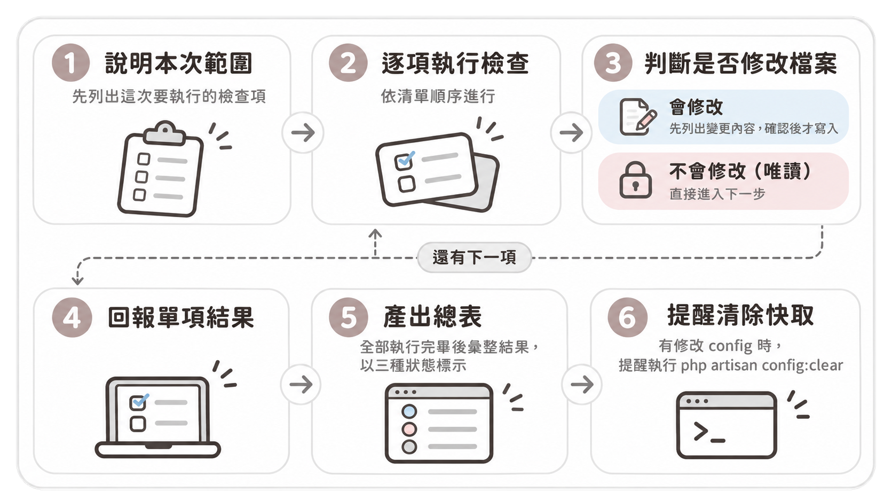

## 🔍 前言

工作上每完成一個 Laravel CMS 專案，交付上線前都有一份固定要跑的檢查清單：文字編輯器欄位、H 標籤、sitemap、XSS 防護⋯⋯

每一項都不難，但每個專案都得從頭檢查一遍，不僅繁瑣，還很容易有遺漏 😵

於是我請 AI 把這套流程寫成 agent，**把繁瑣又非做不可的檢查交給 AI**，自己只需要確認結果

---

## 🤖 agent 簡介

`laravel-project-check` 是 Laravel CMS 專案上線前、交付前使用的檢查 agent：

- 依固定清單執行 **6 個檢查項**，最後產出一張 **三態總表**
- 會修改檔案的項目，一律 **先列出變更，確認後才寫入**

---

## 📋 檢查清單總覽

檢查項分成兩種，各自依據不同的作業準則：

- **Skill 型**：依對應 Skill 的 `SKILL.md` 執行
- **agent 內建型**：依 agent 定義檔中「檢查項細則」章節的規則執行

agent 會依下表順序逐項執行

| 順序 | 檢查項 | 作業準則 | 會修改的檔案 | 寫入時機 |
| --- | --- | --- | --- | --- |
| 1 | 文字編輯器替換欄位 | Skill `laravel-change-content-path` | `config/{unit_type}/{單元}/basic.php` 的 `exp_fields` | 確認後補上欄位 |
| 2 | 前台 H 標籤規則 | agent 內建 | 預設不修改 | 只回報；能明確修正的項目，確認後才修改 |
| 3 | 單元 sitemap 產生設定 | Skill `laravel-sitemap-config` | 各單元的 `create_sitemap_unit`／`create_sitemap_m`／`create_sitemap` | 確認後修正 |
| 4 | nl2br 安全輸出 | agent 內建 | 前台 blade | 確認後修正 |
| 5 | 編輯器共用樣式一致性 | agent 內建 | `public/scss/textEditor.scss` | 確認後同步 |
| 6 | 後台欄位前台使用 | Skill `laravel-backend-field-usage` | 後台 blade、`basic.php` 的 `image_set_path` | 使用者指定要隱藏的項目後才修改 |

---

## 🚀 如何啟動

在 Laravel 專案目錄下，直接用一句話說出需求，Claude Code 就會自動啟動 agent

| 想做的事 | 可以這樣說 |
| --- | --- |
| 執行完整清單 | 「幫我跑一次專案檢查」「這個專案要上線了，先檢查一下設定有沒有漏」 |
| 只檢查文字編輯器欄位 | 「檢查一下文字編輯器的欄位設定有沒有問題」 |
| 只檢查 H 標籤 | 「檢查 H 標籤」 |
| 只檢查 sitemap | 「檢查 sitemap 設定」 |
| 只檢查 nl2br | 「檢查 nl2br」「XSS 檢查」 |
| 只檢查編輯器樣式 | 「檢查編輯器樣式」「textEditor 樣式一致」 |
| 只檢查後台欄位 | 「後台欄位前台有沒有用」「沒用到的後台欄位」 |

說「上線前檢查」「健檢」「project check」也會啟動；指定其中幾項，就只執行那幾項

---

## 🔎 各檢查項說明

### 1. 文字編輯器替換欄位

將後台的 `advanceTextarea` 欄位補進 `basic.php` 的 `exp_fields`，TinyMCE 的上傳路徑才會被正確替換

只新增缺少的欄位、不更動既有設定，並排除 `necessary/dashboard/`

### 2. 前台 H 標籤規則

掃描前台 blade，檢查 H1～H3 的數量與層級是否正確。透過 `@include` 引入的 partial 也一併納入，H1 以整頁合計計算

| 頁面類型 | 判斷依據 | `<h1>` | `<h2>` | `<h3>` |
| --- | --- | --- | --- | --- |
| 首頁 | `frontend/unit/home/index.blade.php` | 全頁一個，通常在 banner 標題 | 各區塊標題（`titleBox > title`） | 各區塊的資料標題（`XXXBox`／`XXXList > title`） |
| 內頁：有類別 + 內頁圖文 | 頁面出現 `classCurrent` | 全頁一個，通常在 `Banner_ins` 標題 | 類別標題（`classCurrent` 內） | 各筆資料標題 |
| 內頁：只有內頁 | 沒有 `classCurrent` | 資料標題（`articleTitle`） | 無規定 | 無規定 |

| 狀況 | 判定 |
| --- | --- |
| 麵包屑 `bread` 內有 `<h1>`～`<h6>` | ❌ |
| H1 數量為 0 或超過 1、層級錯置 | ❌ |
| 標題由編輯器欄位（`data_exp`）輸出 | ⚠️ |
| 出現 `<h4>`～`<h6>`，或無法判定頁面類型 | ⚠️ |

### 3. 單元 sitemap 產生設定

比對前台路由與各單元的 `create_sitemap_unit`、`create_sitemap_m`、`create_sitemap`，修正會產生 404 網址的設定

符合標準規則的項目，列出後直接修正；例外情況則先詢問再處理

### 4. nl2br 安全輸出

`nl2br()` 不會跳脫 HTML，直接輸出使用者輸入的內容會有 **XSS 風險**

agent 會找出前台所有的 `nl2br(`，逐筆判斷是否需要修正

```blade
{{-- 修正前 --}}
{!! nl2br($row->data_introduction) !!}

{{-- 修正後 --}}
{!! nl2br(e($row->data_introduction)) !!}
```

| 欄位類型 | 處理方式 |
| --- | --- |
| textarea 純文字（如 `data_introduction`、`data_address`） | 加上 `e()` |
| TinyMCE 富文本（如 `data_exp`、`data_content`） | 不加，加了會破壞格式 |
| 無法判定 | ⚠️ 請使用者確認 |

### 5. 編輯器共用樣式一致性

確保 `textEditor.scss` 的標題與按鈕樣式和前台 `master.scss` 一致，**以 `master.scss` 為準**

兩者不同步時，後台編輯器預覽的樣式就會和前台實際顯示的不一樣

| `master.scss`（權威來源） | `textEditor.scss`（`.textEditor` 區塊內） |
| --- | --- |
| `.titleBox .decoTitle` | `.decoTitle` |
| `.titleBox .title` | `.title` |
| `.titleBox .subtitle` | `.subtitle` |
| `.btnBox` 直屬的 `.btn { ... }`（含巢狀選擇器、修飾 class、`@include media`、`@include hover`） | `.btnBox` 直屬的 `.btn { ... }` |

比對對象是 SCSS 原始碼（`public/scss/{主語系}/master.scss` 與 `public/scss/textEditor.scss`），會忽略空白、註解與宣告順序的差異

| 差異類別 | 說明 | 處理方式 |
| --- | --- | --- |
| 缺少 | `master.scss` 有、`textEditor.scss` 沒有 | 補進 `textEditor.scss` |
| 值不同 | 兩邊都有，但值或 mixin 參數不同 | 改成 `master.scss` 的寫法 |
| 多出 | `textEditor.scss` 有、`master.scss` 沒有 | 逐筆列出請使用者確認，未確認前不更動 |

- 只修改 `textEditor.scss`，不更動 `master.scss` 與 `public/css/`
- 使用到 `_setting.scss` 以外才定義的變數或 mixin，或多語系的 `master.scss` 彼此不一致時，列為 ⚠️
- 修正後需重新編譯 `public/css/textEditor.css` 與 `public/backend/css/backend_bootstrap.css`

### 6. 後台欄位前台使用

盤點後台的首頁開關、對應功能、類別顏色、圖片欄位，以及 ins 頁的填寫欄位，確認前台是否實際用到；同時找出列表頁用 `d-none` 隱藏、卻沒有生效的欄位

流程分成兩階段：**先盤點、回報後暫停 → 使用者指定要隱藏的項目後才動手**，未指定的項目維持原狀

隱藏方式：

- 一般欄位先用 `d-none`；列表頁欄位若 `d-none` 無效，改用 Blade 註解
- 圖片欄位與列表圖一律修改 `config/unit/{unit}/basic.php` 的 `image_set_path`，不在 Blade 用註解或 `d-none` 處理

| 狀態 | 條件 |
| --- | --- |
| ✅ | 沒有未使用的項目，也沒有 `d-none` 未生效的列表頁欄位 |
| ⚠️ | 有未使用的項目待使用者決定，或已依指定完成隱藏 |
| ❌ | 列表頁有 `d-none` 未生效、尚未改成註解的欄位（列表圖則是尚未修改 `image_set_path`） |

---

## 🗺️ 執行流程



1. **說明本次範圍**：先列出這次要執行的檢查項
2. **逐項執行檢查**：依清單順序進行
3. **判斷是否修改檔案**
   - **會修改** → 先列出變更內容，確認後才寫入
   - **不會修改（唯讀）** → 直接進入下一步
4. **回報單項結果**：還有下一項時，回到步驟 2
5. **產出總表**：全部執行完畢後彙整結果，以三種狀態標示
6. **提醒清除快取**：有修改 config 時，提醒執行 `php artisan config:clear`

單一項目失敗時，回報後會繼續執行下一項；只有在會影響後續檢查正確性時才會中止

---

## 📊 檢查報告

總表中的所有檢查項，都使用同一套三種狀態標示

| 狀態 | 意義 | 需要做什麼 |
| --- | --- | --- |
| ✅ 通過 | 符合規則 | 不需處理 |
| ⚠️ 需人工確認／已補正 | 已自動補正，或無法自動判定 | 檢視補正內容，或自行確認該項目 |
| ❌ 需手動處理 | 發現違規或缺漏，且尚未處理 | 手動修正 |

❌ 與 ⚠️ 的項目都會附上檔案路徑與行號

Skill 型檢查項的單項報告，則依該 Skill 規定的格式輸出

---

## 🧩 如何擴充檢查清單

新增檢查項時，只需要編輯 `~/.claude/agents/laravel-project-check.md`

1. 在「檢查清單（Check List）」表格新增一列，填入順序、檢查項名稱、作業準則與用途
2. 依檢查項類型補上作業準則：
   - **Skill 型**：「作業準則」欄填入 Skill 名稱，並確認該 Skill 已安裝
   - **agent 內建型**：「作業準則」欄填入「agent 內建」，並在「檢查項細則」章節新增一節，寫明掃描範圍、判斷規則、修正方式、回報內容，以及三種狀態的判定條件
3. 更新「標準流程」第 2 步列出的項次編號
4. 在 frontmatter 的 `description` 補上新檢查項的說明與觸發詞，Claude Code 才會在對應情境下啟動 agent

新的檢查項同樣沿用三種狀態標示；會修改檔案的項目，也一樣要先確認才寫入

---

## ⚠️ 注意事項與限制

- **工作目錄**：找不到 `artisan`、`config/`、`resources/views/backend/` 時，agent 會先回報，請使用者確認目錄是否正確
- **不猜測**：遇到不符合既定規則的 blade 路徑，或無法判定的頁面結構，一律列為 ⚠️ 回報
- **缺少 Skill 時**：對應的 Skill 不存在或無法載入時，略過該項並說明原因，其餘項目照常執行
- **處理範圍**：只處理程式檔案與設定，不更動使用者上傳的資料
- **樣式檔**：只修改 SCSS 原始檔，編譯產物需由使用者自行重新編譯
- **記憶**：agent 會把專案特有的結構特例，以及使用者對檢查流程的偏好，記錄在 `~/.claude/agent-memory/laravel-project-check/`，供之後的檢查沿用。這份記憶是跨專案共用的
