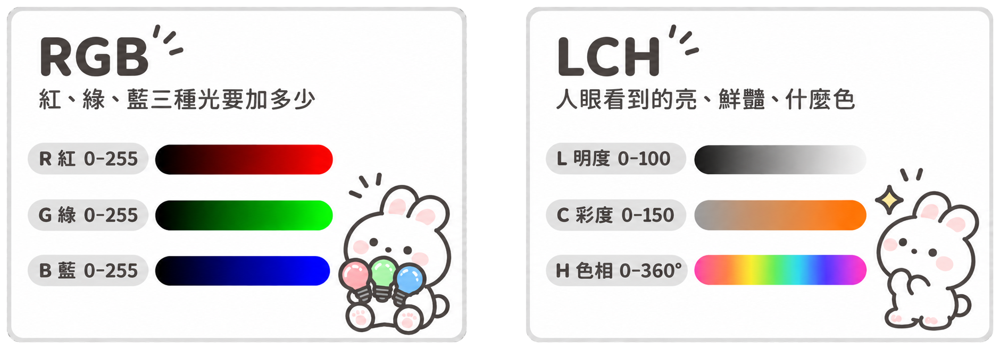
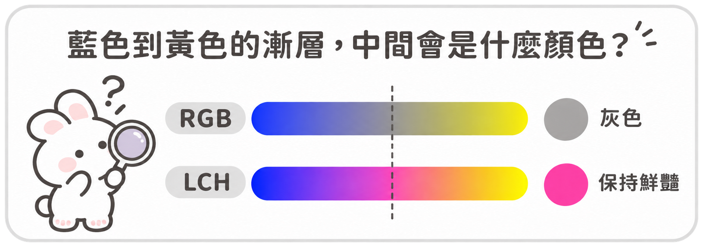
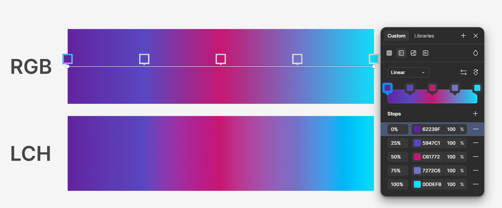
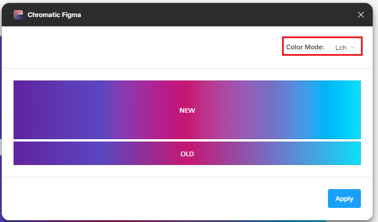
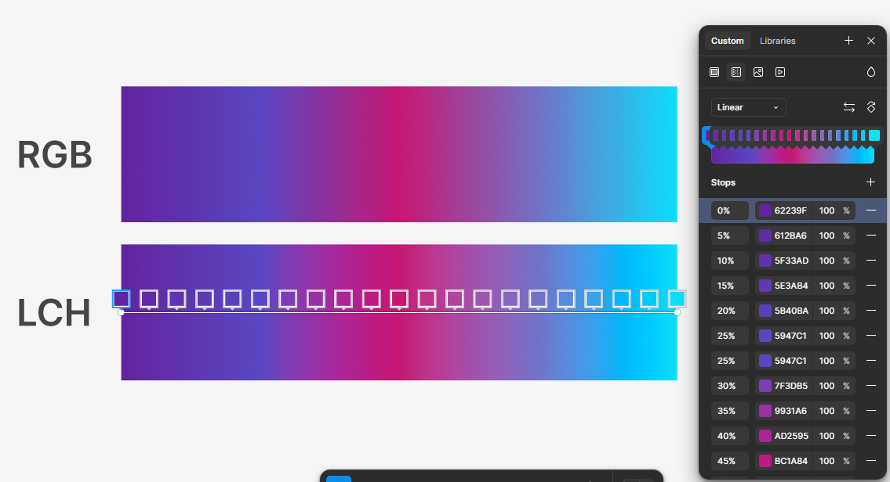

## 🔍 前言

想用漸層做動畫時，常會發現顏色總是「髒髒的」、過渡不順，中間甚至變得灰濁 😵

其實是因為一般使用的 **RGB 色彩模式** 不是最適合做漸層的選擇

改成 **LCH 色彩模式**，就能讓漸層更自然、色彩更乾淨 ✨

> [!TIP]
> 文中的 CodePen 範例都可以直接操作，點右上角「Edit on CodePen」還能開到 CodePen 修改

---

## 🎨 LCH 跟 RGB 是什麼？



### RGB（Red, Green, Blue）

基於 **光線混合** 的色彩模式，用紅、綠、藍三種光的強度組合出各種顏色

| 通道 | 意思 | 範圍 |
| --- | --- | --- |
| R | 紅色光的強度 | 0（沒有）～ 255（最強） |
| G | 綠色光的強度 | 0 ～ 255 |
| B | 藍色光的強度 | 0 ～ 255 |

### LCH（Lightness, Chroma, Hue）

基於 CIELAB 色彩空間，**更符合人眼感知** 的色彩表示法

| 通道 | 意思 | 範圍 |
| --- | --- | --- |
| L 明度 | 顏色有多亮，0 是黑、100 是白 | 0 ～ 100 |
| C 彩度 | 顏色有多鮮豔，數值越高越飽和 | 0 ～ 約 150 |
| H 色相 | 用角度表示是什麼顏色 | 0° ～ 360° |

> [!NOTE]
> LCH 的色相角度跟 HSL 不一樣：大約 **40° 是紅色、100° 是黃色、135° 是綠色、300° 是藍色**，不是 HSL 的 0°、60°、120°、240°

---

## 🤔 為什麼 RGB 漸層會髒髒的？

漸層的中間色，是瀏覽器把頭尾兩個顏色「取平均」算出來的

問題在 **RGB 是三個通道各自取平均**，以藍色到黃色為例：



| | R | G | B | 結果 |
| --- | --- | --- | --- | --- |
| 藍色 | 0 | 0 | 255 | |
| 黃色 | 255 | 255 | 0 | |
| **中間** | 128 | 128 | 128 | 😐 灰色 |

兩個鮮豔的顏色，混出來的中間色卻是灰的，漸層就會出現一段灰濁帶

LCH 則是讓 **明度、彩度、色相各自過渡**，彩度不會在中間掉下來，所以顏色一路都很鮮豔 🤩

---

## 🎭 LCH vs. RGB 差在哪？

### ✅ 更直覺的色彩控制

LCH 的三個屬性是獨立的，**調整亮度不會影響色相和彩度**，可以精準地改變顏色

RGB 是加色混合，想把顏色調亮就要三個數值一起改，常常調一調顏色就跑掉了

### 👀 更符合人眼視覺

LCH 是根據人眼的感知設計的，**相同的數值變化，看起來的變化幅度也差不多**

在 RGB 裡，同樣把數值加 50，紅色和藍色看起來的變化可能差很多；LCH 的變化就均勻得多，更容易控制

### 🎨 設計師的好幫手

LCH 在 UI 設計、配色、印刷上都很實用

UI 設計時用 LCH 調整明度，可以確保 **對比度足夠又不會讓顏色失真**，對無障礙設計來說特別重要 💡

---

## 🪄 實際案例：福哥

這是福哥官網首頁的漸層背景動畫

**RGB 模式**：框起來的地方可以看到不自然的灰濁帶，甚至出現分界線


**轉換成 LCH 後** ⬇️：漸層過渡均勻，不會有突兀的色調變化


### 自己比較看看

用案例的三個顏色做的比較，可以換顏色試試看。`oklch` 是 LCH 的改良版，後面會介紹 👇

:::codepen{title="RGB vs LCH 漸層比較" height="440"}
```html
<div class="pickers">
  <label>顏色 1 <input type="color" id="c1" value="#62239f"></label>
  <label><input type="checkbox" id="use2" checked> 顏色 2 <input type="color" id="c2" value="#c81d6e"></label>
  <label>顏色 3 <input type="color" id="c3" value="#12d9f2"></label>
  <button id="preset">試試藍 → 黃</button>
</div>
<div class="row"><span>srgb</span><div class="bar" data-space="srgb"></div></div>
<div class="row"><span>lch</span><div class="bar" data-space="lch"></div></div>
<div class="row"><span>oklch</span><div class="bar" data-space="oklch"></div></div>
```
```css
body {
  padding: 1.25rem;
  font-family: system-ui, sans-serif;
  color: #2d2a26;
  background: #fbf5e9;
}

.pickers {
  display: flex;
  flex-wrap: wrap;
  align-items: center;
  gap: 0.75rem 1.25rem;
  margin-bottom: 1.25rem;
}

.pickers label {
  display: flex;
  align-items: center;
  gap: 0.4rem;
}

button {
  padding: 0.35rem 0.9rem;
  border: 2px solid #2d2a26;
  border-radius: 999px;
  background: #fff;
  cursor: pointer;
}

.row {
  display: grid;
  grid-template-columns: 4rem 1fr;
  align-items: center;
  gap: 1rem;
  margin-bottom: 1rem;
}

.row span {
  font-family: monospace;
  font-weight: 700;
}

.bar {
  height: 80px;
  border-radius: 12px;
}
```
```js
const [c1, c2, c3] = ["c1", "c2", "c3"].map((id) => document.getElementById(id));
const use2 = document.getElementById("use2");

function render() {
  const colors = [c1.value, use2.checked ? c2.value : null, c3.value]
    .filter(Boolean)
    .join(", ");
  document.querySelectorAll(".bar").forEach((bar) => {
    // in srgb / in lch / in oklch 指定漸層用哪個色彩空間計算
    bar.style.background = `linear-gradient(in ${bar.dataset.space} to right, ${colors})`;
  });
}

[c1, c2, c3, use2].forEach((el) => el.addEventListener("input", render));

// 藍到黃：RGB 中間會變成灰色
document.getElementById("preset").addEventListener("click", () => {
  c1.value = "#0000ff";
  c3.value = "#ffff00";
  use2.checked = false;
  render();
});

render();
```
:::

按下「試試藍 → 黃」可以看到 RGB 正中間變成灰色

`lch` 和 `oklch` 中間走的顏色不一樣，是因為藍色和黃色在兩個色彩空間的色相角度不同，瀏覽器會各自挑「比較近」的方向繞過色相環

---

## 💻 CSS 也能直接用 LCH 漸層

現在的瀏覽器可以直接在 `linear-gradient()` 裡 **指定用哪個色彩空間計算**，不用再靠工具補色：

```css ins={6}
.rgb {
  background: linear-gradient(to right, #62239f, #c81d6e, #12d9f2);
}

.lch {
  background: linear-gradient(in lch to right, #62239f, #c81d6e, #12d9f2);
}
```

`radial-gradient()`、`conic-gradient()` 和混色用的 `color-mix()` 也一樣：

```css
.radial {
  background: radial-gradient(in lch, #62239f, #12d9f2);
}

.mix {
  /* 兩色各半，在 LCH 空間混色 */
  background: color-mix(in lch, #62239f, #12d9f2);
}
```

### 漸層動畫

案例那種流動的背景，可以把漸層放大再移動 `background-position`。左右兩邊只差在 `in lch` 👇

:::codepen{title="RGB vs LCH 漸層動畫" height="360"}
```html
<div class="hero rgb"><span>RGB</span></div>
<div class="hero lch"><span>LCH</span></div>
```
```css
body {
  display: grid;
  grid-template-columns: 1fr 1fr;
  gap: 1rem;
  height: 100vh;
  margin: 0;
  padding: 1rem;
  box-sizing: border-box;
  background: #fbf5e9;
}

.hero {
  display: grid;
  place-items: center;
  border-radius: 16px;
  background-size: 300% 300%;
  animation: flow 6s ease-in-out infinite alternate;
}

.rgb {
  background-image: linear-gradient(135deg, #62239f, #c81d6e, #12d9f2, #62239f);
}

.lch {
  background-image: linear-gradient(in lch 135deg, #62239f, #c81d6e, #12d9f2, #62239f);
}

.hero span {
  padding: 0.4rem 1rem;
  border-radius: 999px;
  background: rgba(255, 255, 255, 0.85);
  font: 700 1.25rem system-ui, sans-serif;
}

@keyframes flow {
  from {
    background-position: 0% 0%;
  }
  to {
    background-position: 100% 100%;
  }
}
```
:::

### LCH 還是 OKLCH？

CSS 還支援 `oklch`，是修正過 LCH 缺點的版本：

| | LCH | OKLCH |
| --- | --- | --- |
| 基礎 | CIELAB | Oklab |
| 藍色漸層 | 容易偏紫 | 比較不會偏色 |
| 適合 | 跟 Figma 外掛等工具的結果一致 | 新寫的 CSS |

> [!TIP]
> 想跟設計稿（Chromatic 外掛的 LCH 模式）結果一致就用 `in lch`；自己寫 CSS 的話，`in oklch` 通常更穩定

### 瀏覽器支援

漸層的色彩空間語法（`in lch`、`in oklch`）在 Chrome / Edge 111+、Safari 16.2+、Firefox 127+ 都能用

不支援的瀏覽器會整行忽略，可以先寫一般漸層當備案：

```css
.hero {
  background: linear-gradient(to right, #62239f, #c81d6e, #12d9f2);
  background: linear-gradient(in lch to right, #62239f, #c81d6e, #12d9f2);
}
```

> [!NOTE]
> 支援狀況可以到 [Can I Use](https://caniuse.com/mdn-css_types_image_gradient_linear-gradient_interpolation_color_space) 確認

---

## 🛠️ 設計稿怎麼轉成 LCH？

### 線上轉換工具

| 工具 | 特色 |
| --- | --- |
| [David Johnstone](http://davidjohnstone.net/lch-lab-colour-gradient-picker) | 可以新增多個顏色，不會產生 CSS |
| [Learn UI Design](https://www.learnui.design/tools/gradient-generator.html) | 漸層最多三個顏色，會產生 CSS |

### Figma 外掛：[Chromatic Figma](https://www.figma.com/community/plugin/759433498184507623/chromatic-figma)（推薦 👍）

使用方式非常簡單，三個步驟：

**1. 選取要轉換的漸層物件**

原本的漸層只有 5 個色標，用的是 RGB 計算



**2. 開啟外掛，Color Mode 選擇 LCH，點擊 Apply**

上方的 NEW 是轉換後的預覽，下方的 OLD 是原本的漸層，可以先比較再決定



**3. 完成**

外掛會在原本的色標之間自動補上中間色，讓 Figma 的 RGB 漸層看起來跟 LCH 一樣



> [!TIP]
> 外掛補出來的色標，切版時可以直接照抄成 CSS；如果瀏覽器支援度沒問題，直接用 `in lch` 會更簡潔

---

## 🏆 結論

- 😐 RGB 漸層是三個通道各自取平均，中間色容易變灰
- ✨ LCH 讓明度、彩度、色相各自過渡，漸層乾淨又自然
- 💻 CSS 加上 `in lch` 或 `in oklch` 就能用，設計稿可以用 Chromatic 外掛轉換

做漸層、尤其是漸層動畫時，記得換成 LCH 試試看 🎨✨
