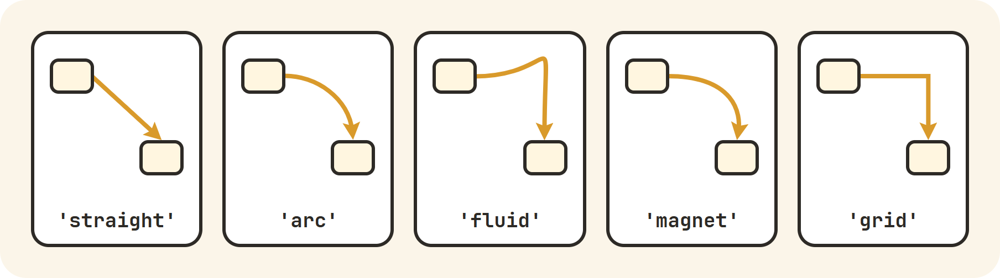
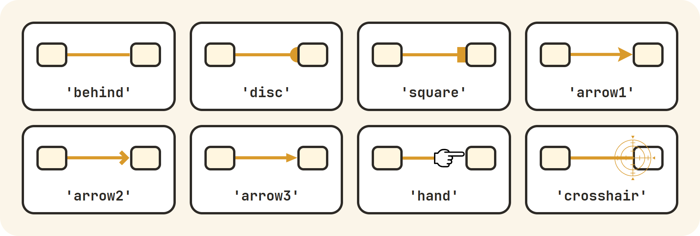
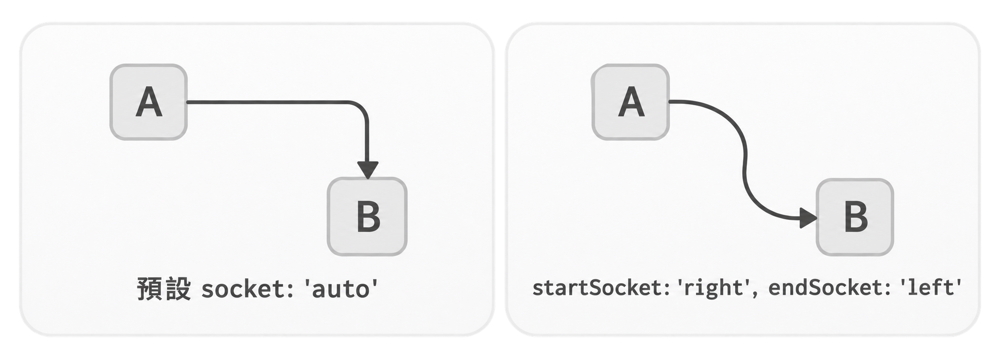

## 🔍 前言

做流程圖、節點編輯器的時候，常常需要在兩個元素之間畫一條線

自己用 SVG 算座標很麻煩，**Leader Line** 只要給它起點和終點兩個元素，就會自動畫出連線 ✨

::github{repo="II-alex-II/leader-line-new"}

> [!NOTE]
> 原版的 `leader-line` 已經很久沒更新，這篇用的是社群維護的 fork `leader-line-new`，修掉了原版幾個已知問題

> [!TIP]
> 文中的 CodePen 範例都可以直接操作，點右上角「Edit on CodePen」還能開到 CodePen 修改

---

## 📦 安裝方式

**CDN 引入**

```html
<script src="https://cdn.jsdelivr.net/npm/leader-line-new@1.1.9/leader-line.min.js"></script>
```

**npm 安裝**

```bash
npm install leader-line-new
```

```js
import LeaderLine from 'leader-line-new';
```

---

## 🚀 基本用法

傳入兩個 DOM 元素就好：

```html
<div id="start">起點</div>
<div id="end">終點</div>

<script>
  new LeaderLine(
    document.getElementById('start'),
    document.getElementById('end')
  );
</script>
```

什麼選項都不給的話，預設是 **珊瑚色（`coral`）、粗 4px 的流線型曲線，終點帶一個箭頭**

---

## 🎨 常用設定選項

第三個參數可以傳入選項物件，自訂連線外觀：

```js
new LeaderLine(startElement, endElement, {
  path: 'fluid',              // 連線路徑類型
  color: 'rgba(0,0,0,0.12)',  // 線條顏色
  size: 1.4,                  // 線條粗細（px）
  startPlug: 'disc',          // 起點端點樣式
  endPlug: 'disc',            // 終點端點樣式
});
```

### path：連線路徑



| 值 | 說明 |
| --- | --- |
| `'straight'` | 直線 |
| `'arc'` | 弧線 |
| `'fluid'` | 流線型曲線（**預設**），適合節點式 UI |
| `'magnet'` | 磁吸式，從元素的邊垂直出去再轉彎 |
| `'grid'` | 直角折線 |

### plug：端點樣式

起點和終點可以分開設定不同的造型：



| 值 | 說明 |
| --- | --- |
| `'behind'` | 沒有端點，線藏在元素後面（**起點預設**） |
| `'disc'` | 實心圓點 |
| `'square'` | 方形 |
| `'arrow1'` | 箭頭樣式 1（**終點預設**） |
| `'arrow2'` | 箭頭樣式 2 |
| `'arrow3'` | 箭頭樣式 3 |
| `'hand'` | 手指指向 |
| `'crosshair'` | 十字瞄準 |

### 自己玩玩看

切換下面的選項，看看連線怎麼變化。兩個方塊都可以拖曳 👇

:::codepen{title="Leader Line 選項遊樂場" height="460" scripts="https://cdn.jsdelivr.net/npm/leader-line-new@1.1.9/leader-line.min.js"}
```html
<form class="panel" id="panel">
  <label>path
    <select name="path">
      <option>fluid</option><option>straight</option><option>arc</option><option>magnet</option><option>grid</option>
    </select>
  </label>
  <label>startPlug
    <select name="startPlug">
      <option>behind</option><option>disc</option><option>square</option><option>arrow1</option><option>arrow2</option><option>arrow3</option><option>hand</option><option>crosshair</option>
    </select>
  </label>
  <label>endPlug
    <select name="endPlug">
      <option>arrow1</option><option>arrow2</option><option>arrow3</option><option>disc</option><option>square</option><option>behind</option><option>hand</option><option>crosshair</option>
    </select>
  </label>
  <label>color <input type="color" name="color" value="#d99a2b"></label>
  <label>size <input type="range" name="size" min="1" max="12" value="4"></label>
</form>
<div class="box" id="start" style="left: 40px; top: 110px">拖我</div>
<div class="box" id="end" style="left: 360px; top: 260px">也可以拖我</div>
```
```css
body {
  margin: 0;
  height: 100vh;
  font-family: system-ui, sans-serif;
  color: #2d2a26;
  background: #fbf5e9;
}

.panel {
  display: flex;
  flex-wrap: wrap;
  gap: 0.5rem 1rem;
  padding: 0.75rem 1rem;
  font-size: 0.85rem;
  font-family: monospace;
}

.panel label {
  display: flex;
  align-items: center;
  gap: 0.35rem;
}

.box {
  position: absolute;
  padding: 1rem 1.25rem;
  border: 3px solid #2d2a26;
  border-radius: 12px;
  background: #fff6e0;
  font-weight: 700;
  cursor: grab;
  user-select: none;
  touch-action: none;
}
```
```js
const start = document.getElementById("start");
const end = document.getElementById("end");
const panel = document.getElementById("panel");

const line = new LeaderLine(start, end);

// 選項變更時，用 setOptions 一次更新
function applyOptions() {
  const data = new FormData(panel);
  line.setOptions({
    path: data.get("path"),
    startPlug: data.get("startPlug"),
    endPlug: data.get("endPlug"),
    color: data.get("color"),
    size: Number(data.get("size")),
  });
}
panel.addEventListener("input", applyOptions);
applyOptions();

// 拖曳方塊，移動時呼叫 position() 讓連線跟著動
[start, end].forEach((box) => {
  box.addEventListener("pointerdown", (e) => {
    const offsetX = e.clientX - box.offsetLeft;
    const offsetY = e.clientY - box.offsetTop;
    box.setPointerCapture(e.pointerId);

    const move = (ev) => {
      box.style.left = `${ev.clientX - offsetX}px`;
      box.style.top = `${ev.clientY - offsetY}px`;
      line.position();
    };
    box.addEventListener("pointermove", move);
    box.addEventListener("pointerup", () => box.removeEventListener("pointermove", move), { once: true });
  });
});
```
:::

### plug 進階設定

端點的大小、顏色、描邊都可以分開調整：

```js
new LeaderLine(start, end, {
  startPlug: 'disc',
  endPlug: 'disc',
  startPlugSize: 1.5,                  // 起點端點大小倍率
  endPlugSize: 1.5,                    // 終點端點大小倍率
  startPlugColor: 'rgba(0,0,0,0.2)',   // 起點端點顏色
  endPlugColor: 'rgba(0,0,0,0.2)',     // 終點端點顏色
  startPlugOutline: true,              // 起點端點描邊
  endPlugOutline: true,                // 終點端點描邊
  startPlugOutlineColor: 'rgba(255,255,255,0.8)',
  endPlugOutlineColor: 'rgba(255,255,255,0.8)',
  startPlugOutlineSize: 2,             // 描邊粗細倍率
  endPlugOutlineSize: 2,
});
```

---

## 🔄 連線位置更新

Leader Line **不會自動監聽 DOM 變動**

元素位置改變時（視窗縮放、拖曳、動態排版），要自己呼叫 `position()` 重新計算：

```js
const line = new LeaderLine(start, end);

// 單條線更新
line.position();
```

### 搭配 resize 事件

```js
const lines = [];

lines.push(new LeaderLine(startA, endA));
lines.push(new LeaderLine(startB, endB));

function refreshLines() {
  lines.forEach(line => line.position());
}

window.addEventListener('resize', refreshLines);
```

### 搭配圖片載入

元素裡有圖片的話，圖片載入後元素尺寸可能會變，要在載入完成後重新定位：

```js
document.querySelectorAll('img').forEach(img => {
  if (!img.complete) {
    img.addEventListener('load', refreshLines);
  }
});
```

---

## 📍 指定連線從哪裡出發

Leader Line 預設會 **自動挑最近的一邊** 當連接點（`socket: 'auto'`）

元素一移動，連線可能就從右邊跳到上面，做節點式 UI 時會很亂：



### 方法一：指定 socket

固定連線從哪一邊進出，可以用 `'top'`、`'right'`、`'bottom'`、`'left'`：

```js
new LeaderLine(start, end, {
  startSocket: 'right',
  endSocket: 'left',
});
```

### 方法二：pointAnchor 指定座標

想連到元素裡的某個點，例如卡片標題列的高度，用 `LeaderLine.pointAnchor()`：

```js
new LeaderLine(
  LeaderLine.pointAnchor(cardA, { x: '100%', y: 20 }),  // 右邊、往下 20px
  LeaderLine.pointAnchor(cardB, { x: 0, y: 20 }),       // 左邊、往下 20px
);
```

### 方法三：放一個寬高為 0 的錨點元素

在卡片裡放一個寬高為 0 的元素，用 CSS 決定它的位置

好處是 **位置交給 CSS 管理**，RWD 時可以用 media query 換位置：

```html
<div class="card" id="card-a">
  <div class="lineAnchor end"></div>   <!-- 連線終點錨點 -->
  <div class="content">卡片內容</div>
  <div class="lineAnchor start"></div> <!-- 連線起點錨點 -->
</div>
```

```css
.card {
  position: absolute;
}

.lineAnchor {
  position: absolute;
  width: 0;
  height: 0;
}

/* 起點錨點放在右側中間 */
.lineAnchor.start {
  top: 50%;
  right: 0;
}

/* 終點錨點放在左側中間 */
.lineAnchor.end {
  top: 50%;
  left: 0;
}
```

```js
new LeaderLine(
  document.querySelector('#card-a .lineAnchor.start'),
  document.querySelector('#card-b .lineAnchor.end'),
  { path: 'fluid' }
);
```

| 方法 | 適合的情況 |
| --- | --- |
| `startSocket` / `endSocket` | 只要固定從哪一邊進出 |
| `pointAnchor` | 要連到精確的座標 |
| 寬高 0 的錨點元素 | 位置想交給 CSS 管理、RWD 要換位置 |

---

## 🛠️ 實戰範例：可拖曳的節點連線

把上面的技巧組合起來，做一個可以拖曳的節點畫面：

:::codepen{title="Leader Line 可拖曳節點" height="520" scripts="https://cdn.jsdelivr.net/npm/leader-line-new@1.1.9/leader-line.min.js"}
```html
<div class="contentBox">
  <div class="nodeConnect" id="card-source" style="--left: 20px; --top: 40px">
    <div class="lineAnchor end"></div>
    <div class="nodeHeader">Source Photo</div>
    <div class="Img">
      
    </div>
    <div class="lineAnchor start"></div>
  </div>

  <div class="nodeConnect" id="card-model" style="--left: 230px; --top: 170px">
    <div class="lineAnchor end"></div>
    <div class="nodeHeader">Stable Diffusion</div>
    <div class="Img">
      
    </div>
    <div class="lineAnchor start"></div>
  </div>

  <div class="nodeConnect" id="card-output" style="--left: 440px; --top: 50px">
    <div class="lineAnchor end"></div>
    <div class="nodeHeader">Output</div>
    <div class="Img">
      
    </div>
    <div class="lineAnchor start"></div>
  </div>
</div>
```
```css
body {
  margin: 0;
  height: 100vh;
  font-family: system-ui, sans-serif;
  background:
    radial-gradient(circle, #d9d4ca 1px, transparent 1px) 0 0 / 20px 20px,
    #fbf5e9;
}

.nodeConnect {
  position: absolute;
  left: var(--left);
  top: var(--top);
  width: 170px;
  border-radius: 14px;
  background: #fff;
  box-shadow: 0 6px 20px rgba(0, 0, 0, 0.08);
  cursor: grab;
  user-select: none;
}

.nodeHeader {
  padding: 0.6rem 0.8rem;
  font-size: 0.85rem;
  font-weight: 700;
  color: #2d2a26;
}

.Img img {
  display: block;
  width: 100%;
  border-radius: 0 0 14px 14px;
  /* 避免拖曳時觸發瀏覽器原生的圖片拖曳 */
  pointer-events: none;
}

.lineAnchor {
  position: absolute;
  width: 0;
  height: 0;
}

.lineAnchor.start {
  top: 50%;
  right: 0;
}

.lineAnchor.end {
  top: 50%;
  left: 0;
}
```
```js
const lineOptions = {
  path: "fluid",
  startPlug: "disc",
  endPlug: "disc",
  color: "rgba(0, 0, 0, 0.3)",
  size: 1.4,
  startPlugColor: "rgba(0,0,0,0.4)",
  endPlugColor: "rgba(0,0,0,0.4)",
  startPlugSize: 1.5,
  endPlugSize: 1.5,
  startPlugOutline: true,
  endPlugOutline: true,
  startPlugOutlineColor: "rgba(255,255,255,0.8)",
  endPlugOutlineColor: "rgba(255,255,255,0.8)",
  startPlugOutlineSize: 2,
  endPlugOutlineSize: 2,
};

const lines = [];
const connect = (from, to) => {
  lines.push(
    new LeaderLine(
      document.querySelector(`${from} .lineAnchor.start`),
      document.querySelector(`${to} .lineAnchor.end`),
      lineOptions
    )
  );
};

connect("#card-source", "#card-model");
connect("#card-model", "#card-output");

const refreshLines = () => lines.forEach((line) => line.position());

// 圖片載入後卡片高度會變，要重新定位
document.querySelectorAll("img").forEach((img) => {
  if (!img.complete) img.addEventListener("load", refreshLines);
});
window.addEventListener("resize", refreshLines);

// 拖曳 + 連線跟隨
document.querySelectorAll(".nodeConnect").forEach((card) => {
  let isDragging = false;
  let offsetX, offsetY;

  card.addEventListener("mousedown", (e) => {
    isDragging = true;
    offsetX = e.clientX - card.offsetLeft;
    offsetY = e.clientY - card.offsetTop;
  });

  document.addEventListener("mousemove", (e) => {
    if (!isDragging) return;
    card.style.setProperty("--left", `${e.clientX - offsetX}px`);
    card.style.setProperty("--top", `${e.clientY - offsetY}px`);
    refreshLines();
  });

  document.addEventListener("mouseup", () => {
    isDragging = false;
  });
});
```
:::

拆開來看重點：

### HTML 結構

每張卡片左右各放一個錨點，`--left`、`--top` 是卡片的位置：

```html
<div class="nodeConnect" id="card-source" style="--left: 20px; --top: 40px">
  <div class="lineAnchor end"></div>
  <div class="nodeHeader">Source Photo</div>
  <div class="Img">
    
  </div>
  <div class="lineAnchor start"></div>
</div>
```

```css {3-4}
.nodeConnect {
  position: absolute;
  left: var(--left);
  top: var(--top);
}
```

### 建立連線

```js
const lineOptions = {
  path: 'fluid',
  startPlug: 'disc',
  endPlug: 'disc',
  color: 'rgba(0, 0, 0, 0.3)',
  size: 1.4,
  // …端點設定同上方「plug 進階設定」
};

const lines = [];

lines.push(new LeaderLine(
  document.querySelector('#card-source .lineAnchor.start'),
  document.querySelector('#card-model .lineAnchor.end'),
  lineOptions
));
```

### 拖曳 + 連線跟隨

```js {15-16}
document.querySelectorAll('.nodeConnect').forEach(card => {
  let isDragging = false;
  let offsetX, offsetY;

  card.addEventListener('mousedown', e => {
    isDragging = true;
    offsetX = e.clientX - card.offsetLeft;
    offsetY = e.clientY - card.offsetTop;
  });

  document.addEventListener('mousemove', e => {
    if (!isDragging) return;
    card.style.setProperty('--left', `${e.clientX - offsetX}px`);
    card.style.setProperty('--top', `${e.clientY - offsetY}px`);
    // 拖曳過程中即時更新所有連線位置
    lines.forEach(line => line.position());
  });

  document.addEventListener('mouseup', () => {
    isDragging = false;
  });
});
```

重點是在 `mousemove` 裡每次移動都呼叫 `position()`，連線才會即時跟著卡片走

> [!TIP]
> 卡片裡有圖片時，記得幫 `img` 加上 `pointer-events: none`，不然按住圖片拖曳會觸發瀏覽器原生的「拖曳圖片」，卡片就拖不動了

---

## 🧰 其他實用 API

```js
const line = new LeaderLine(start, end);

// 顯示 / 隱藏
line.show();
line.hide();

// 移除連線
line.remove();

// 動態修改選項
line.color = 'red';
line.size = 3;
line.path = 'arc';

// 一次修改多個選項
line.setOptions({ color: 'red', size: 3, path: 'arc' });

// 搭配動畫效果顯示 / 隱藏
line.show('draw');     // 繪製動畫
line.show('fade');     // 淡入
line.hide('fade');     // 淡出
```

---

## ⚠️ 注意事項

**1. 連線是插在 `<body>` 底部的 SVG**

連線不在卡片的 DOM 裡，父層的 `overflow: hidden` 裁不到它，捲動容器裡的元素捲走了，連線也不會跟著消失

**2. 不會自動追蹤位置**

resize、捲動、拖曳、動態內容，任何會讓元素移動的操作都要自己呼叫 `position()`

**3. 大量連線的效能**

頁面上有幾十條以上的連線時，每次 `mousemove` 都更新會很吃效能，可以用 `requestAnimationFrame` 節流：

```js
let ticking = false;

function refreshLines() {
  if (ticking) return;
  ticking = true;
  requestAnimationFrame(() => {
    lines.forEach(line => line.position());
    ticking = false;
  });
}
```

---

## 🏆 結論

Leader Line 把「兩個元素之間畫線」這件事變得很簡單：

- ✅ 傳入兩個元素就能畫線，路徑、端點、顏色都能自訂
- ✅ 用 socket、`pointAnchor` 或錨點元素控制連接位置
- ⚠️ 位置變動時要記得自己呼叫 `position()`

做流程圖、節點編輯器、教學導覽的指示線都很好用 🎉
