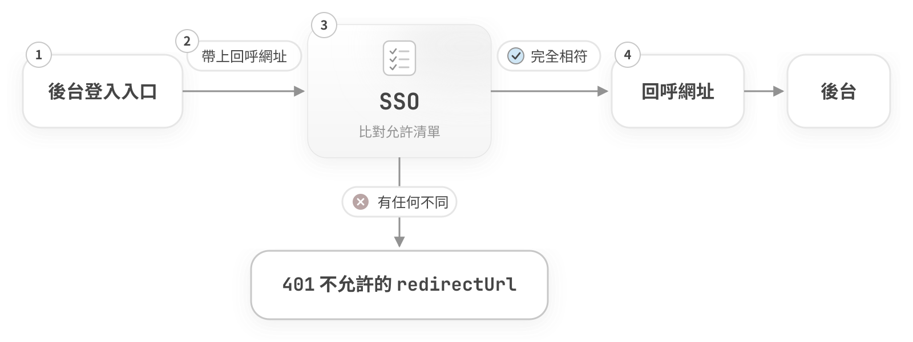
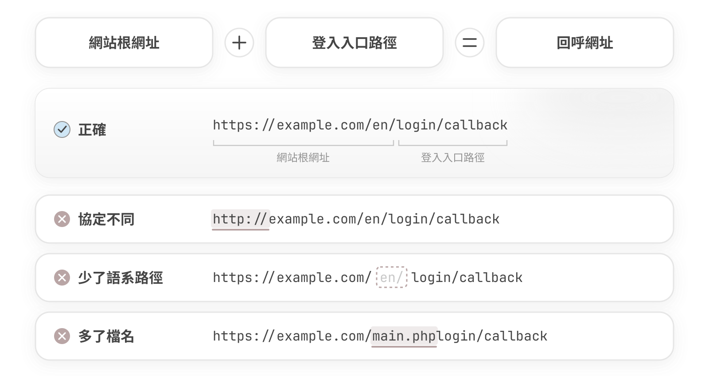
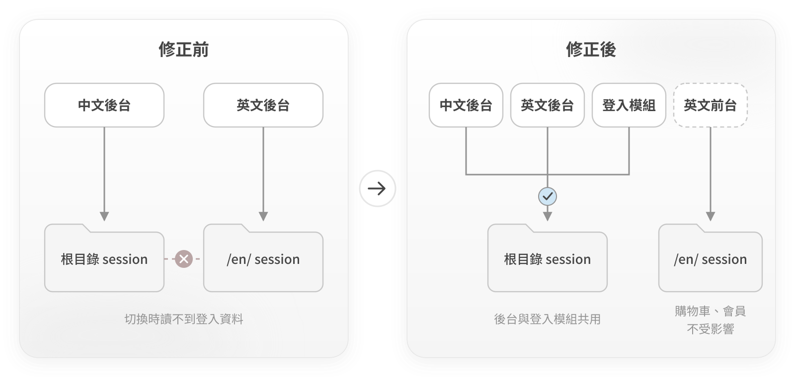

## 🔍 前言

最近工作上陸續幫幾個 **約 2015～2017 年** 的老專案，把 PHP 從 5.6 升級到 7.4

升級本身很順利，但上線後檢查時，發現了兩類問題：

- **線上**：後台的 SSO 登入跳不過去，多語系的後台切換語系還會被踢回前台首頁
- **本機**：要在本機修改時，整個站打不開

追查之後發現，**這些問題都不是升級造成的**，而是原本就存在、只是沒人碰到。

為了避免之後遇到問題不知道如何解決，於是寫這篇文章把每個問題的症狀、原因和修正思路記錄下來

---

## 🔐 第一部分：後台 SSO 登入失敗

### 一、先了解登入流程

這批老專案的後台，約莫在 2025-2026 年加上 **SSO 登入入口**，登入時會經過這幾步：

1. 後台的登入入口
2. 登入入口把使用者導到 SSO，同時帶上 **回呼網址**（`redirectUrl`），告訴 SSO 登入完要回到哪裡
3. SSO 比對回呼網址是否在 **允許清單** 裡，符合才顯示登入畫面
4. 登入成功後回到回呼網址，再導進後台



問題幾乎都出在第 3 步：  
**SSO 要求回呼網址完全相符**，協定、`www.`、路徑只要有一點不同，就會被拒絕


| 送出的回呼網址                                                | SSO 回應       |
| ------------------------------------------------------ | ------------ |
| `https://example.com/en/login/callback`                | ✅ 200，進到登入畫面 |
| `https://example.com/login/callback`（少了語系路徑）           | ❌ 401        |
| `https://www.example.com/en/login/callback`（多了 `www.`） | ❌ 401        |
| `http://example.com/en/login/callback`（協定不同）           | ❌ 401        |


畫面上看到的錯誤是：

```text
401 不允許的 redirectUrl
```

回呼網址是程式用「網站根網址 + 登入入口路徑」組出來的，所以下面幾個問題，其實都是 **網址組錯了**



### 二、遇到的問題

#### 問題一：本機能登入，線上不行

**原因**：  
網站設定檔裡的網站根網址寫死成 `http://`，但線上已經全站 HTTPS，組出來的回呼網址和 SSO 登記的協定不同

**修正**：  
把協定改成 `https://`

> [!TIP]
> 這是最常見的情況，遇到線上無法跳轉 SSO 時，先檢查這一項

 

#### 問題二：英文版後台無法登入，登入後還跑到中文後台

**原因**：  
多語系的站，英文版放在 `/en/` 子資料夾，但英文版的網站根網址沒有包含 `en/`

- 回呼網址少了 `en/`，SSO 不接受
- 登入後要導向的後台網址也少了 `en/`，就算通過 SSO，也會被導到中文後台

**修正**：  
只在英文版的登入模組設定裡，把回呼網址與後台網址都補上 `en/`

> [!WARNING]
> 不要直接改全站共用的網站根網址。  
> 那個變數全站有幾十處在用，有些地方還會再接上目前的路徑，改了反而會組出 `/en//en/` 這種網址

 

#### 問題三：回呼網址中間多了一個檔名

另一個專案的錯誤訊息一樣是「不允許的 redirectUrl」，但實際送出的網址長這樣：

```text
https://www.example.com/main.phplogin/callback
```

**原因**：  
這個站的首頁要經過一支入口檔，設定檔把「網站所在資料夾」設成了檔名 `main.php`。  
原本那個欄位應該放資料夾，結果網站根網址變成 `https://www.example.com/main.php`，後面再直接接上路徑，就黏成了 `main.phplogin/`

登入後要導向的後台網址也會變成 `main.phpmanage/`，所以就算通過 SSO，下一步一樣會壞

**修正**：  
這個站的入口檔不能拿掉，而全站用到網站根網址的檔案有一百多支，改設定的影響範圍太大。  
所以只在 **登入模組組網址的地方** 加一個判斷：

- 「網站所在資料夾」是 `.php` 結尾的檔名時，先把它從根網址去掉，再接上登入路徑
- 本機的設定是資料夾名稱，不會被影響，網址維持原樣

> [!NOTE]
> 如果網址修正後還是被拒絕，代表 SSO 沒有登記這個回呼網址，要請管理 SSO 的人把它加進允許清單

 

#### 問題四：後台切換語系，被踢回前台首頁

**症狀**：  
在中文後台用下拉選單切到 English，結果被導回前台首頁

**原因**：  
中、英文兩個版本的 session 存在 **不同的資料夾**


| 版本  | session 存放位置             |
| --- | ------------------------ |
| 中文版 | 根目錄的 session 資料夾         |
| 英文版 | `/en/` 底下自己的 session 資料夾 |


切過去之後讀不到登入資料，被判定為未登入，權限檢查就把人導回首頁

**修正**：  
讓英文版的 **後台與登入模組** 改用根目錄的 session 資料夾，判斷方式是看目前執行的程式是否在後台或登入模組的路徑底下  
英文版的 **前台維持獨立**，購物車、會員登入都不受影響



改完之後要注意：

- 英文後台已經登入的人，要重新登入一次
- 登出時，中英文後台會一起登出
- 子帳號切換語系時，會帶著自己可管理的單元進入另一邊的後台

 

#### 問題五：語系下拉選單，一個沒反應、一個 404

**症狀**：  
在英文後台選「中文版」沒有反應，選「English」則是 404，網址變成 `/en/en/manage/`

**原因**：  
英文後台的語系選單是從中文版整支複製過來的，**相對路徑沒有跟著調整**。  
從 `/en/manage/` 出發，中文版要往上多退一層，英文版則是留在原地

**修正**：  
依英文後台所在的位置，重新算兩個選項的相對路徑

### 三、排查步驟

遇到 SSO 跳轉失敗時，可以照這個順序檢查：

1. 用 `curl` 看登入入口實際導向哪裡
   ```bash
   curl -skL -D - https://example.com/login/
   ```
2. 找到回應標頭裡的 `Location`，檢查 `redirectUrl` 的協定、網域、路徑是否都正確
3. 看 SSO 最後的回應：**200** 是正常的登入畫面，**401** 就是回呼網址不符
4. 多語系的站，每個語系通常有各自的 `clientId`，回呼網址要對應到該語系的路徑

### 四、上線時要注意

- 線上和本機的網站設定檔內容不同，**不要整支上傳覆蓋**，線上只改需要的那一行
- 多語系的修正只改 `/en/` 底下的檔案，根目錄的同名檔案不用動
- 存檔時確認是 UTF-8 編碼

---

## 💻 第二部分：本機整站打不開

另一個專案要在本機修改時，`http://localhost/` 正常，只有這個站打不開，前台、後台都一樣

### 一、環境差異


|     | PHP 版本 | 伺服器                   |
| --- | ------ | --------------------- |
| 線上  | 7.4    | cPanel                |
| 本機  | 8.4    | WAMP（Apache mod\_php） |


問題分成三層，**修好一層才看得到下一層**：


| 層   | 畫面                          | 原因                                              |
| --- | --------------------------- | ----------------------------------------------- |
| 1   | 直接印出 PHP 原始碼                | `.htaccess` 裡 cPanel 用來指定 PHP 版本的設定，本機沒有對應的處理程式 |
| 2   | `Parse error: Unclosed '{'` | 程式大量使用 `<? ?>` 短標籤，本機的 `short_open_tag` 是關閉的    |
| 3   | `count()` 的 `TypeError`     | 程式是為 PHP 7.4 寫的，在 PHP 8 會變成致命錯誤                 |


### 二、判斷卡在哪一層

```bash
curl -s http://localhost/站名/ | head -5
```

- 看到 `<?PHP` 開頭 → 第 1 層
- 看到 `Parse error` → 第 2 層
- 看到 `count()` 的 `TypeError` → 第 3 層

### 三、各層的修正

#### 第 1 層：PHP 原始碼被直接印出來

cPanel 會在 `.htaccess` 寫一行 `AddHandler`，把 `.php` 交給指定版本的 PHP 處理：

```apache
AddHandler application/x-httpd-ea-php74 .php .php7 .phtml
```

本機沒有這個處理程式，Apache 不知道要交給誰，就把檔案當成純文字送出，畫面上就看到原始碼

**修正**：  
在本機把這一行註解掉

 

#### 第 2 層：短標籤沒開

舊程式常用 `<?` 而不是 `<?php` 開頭。  
`short_open_tag` 關閉時，PHP 不認得這些區塊，括號對不起來，就出現 `Unclosed '{'`

**修正**：  
在 `.htaccess` 結尾加上只有 mod_php 會讀到的設定，本機開啟短標籤

```apache
# 只有載入 php_module（本機 mod_php）時才生效，線上 cPanel 不受影響
<IfModule php_module>
  php_flag short_open_tag On
</IfModule>
```

 

#### 第 3 層：PHP 8 的 `count()` 變嚴格了

PHP 7.4 的 `count(null)` 只會出警告，**PHP 8 會直接丟出 `TypeError`**，頁面整個中斷：

```text
Fatal error: Uncaught TypeError: count(): Argument #1 ($value) must be of type Countable|array, null given
```

有兩種處理方式：


| 做法                                                                | 優點                | 缺點                         |
| ----------------------------------------------------------------- | ----------------- | -------------------------- |
| 讓這個站在本機改用 PHP 7.4 執行（Apache 的 `mod_fcgid` 搭配 7.4 的 `php-cgi.exe`） | 跟線上版本一致，不用改程式     | 要另外設定虛擬主機與 7.4 的 `php.ini` |
| 修改程式相容 PHP 8，例如把可能是 `null` 的值先轉成陣列再 `count()`                     | 線上 7.4 也能跑，之後升級更順 | 舊程式可能要改很多地方                |


> [!TIP]
> 本機 Apache 如果出現 `Unable to load dynamic library 'curl'`，或呼叫 `curl_init()` 時出現 `undefined function`，是另一個問題：Apache 內附的 OpenSSL 太舊。  
> 把 Apache `bin` 資料夾裡的 `libcrypto-3-x64.dll`、`libssl-3-x64.dll` 換成新版就能解決

### 四、上線時要注意

> [!WARNING]
> 這兩處 `.htaccess` 的修改 **不要上傳**。  
> 線上靠 `AddHandler` 指定 PHP 版本，被註解掉的話，線上可能會改用主機預設的 PHP 版本

打包上傳時排除 `.htaccess`，或上傳前先把 `AddHandler` 那行改回來

---

## 📝 小結


| 症狀                             | 先檢查                                 |
| ------------------------------ | ----------------------------------- |
| 本機能跳轉 SSO，線上不行                 | 網站根網址的協定是不是 `http://`               |
| 出現「不允許的 redirectUrl」           | 用 `curl` 看實際送出的回呼網址，跟 SSO 登記的逐字比對   |
| 多語系後台登入後跑到別的語系                 | 登入成功後導向的後台網址有沒有包含語系路徑               |
| 後台切換語系被踢回首頁                    | 各語系的 session 是否存在不同資料夾              |
| 本機印出 PHP 原始碼                   | `.htaccess` 裡 cPanel 的 `AddHandler` |
| 本機 `Parse error: Unclosed '{'` | `short_open_tag` 有沒有開               |
| 本機 `count()` 的 `TypeError`     | 本機 PHP 版本是否比線上新                     |


這次最大的收穫是：**升級後才發現的問題，不一定是升級造成的**。

先確認舊版本下是不是本來就壞了，才不會往錯的方向修