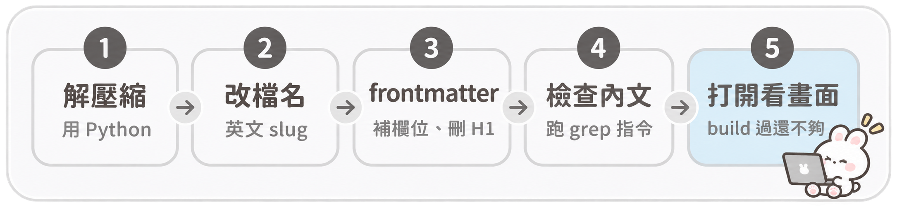
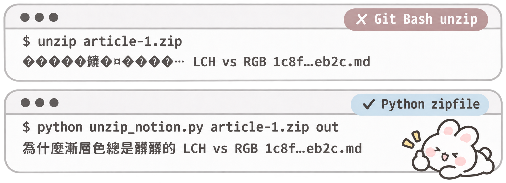
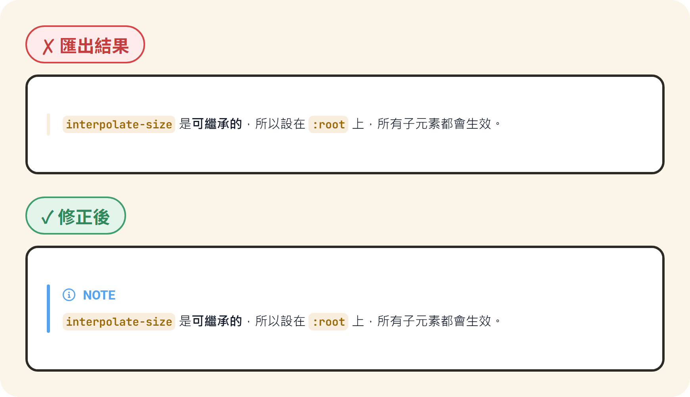
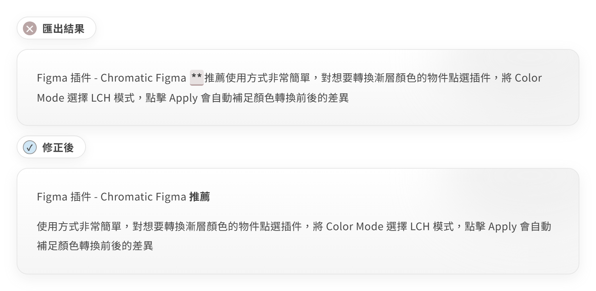
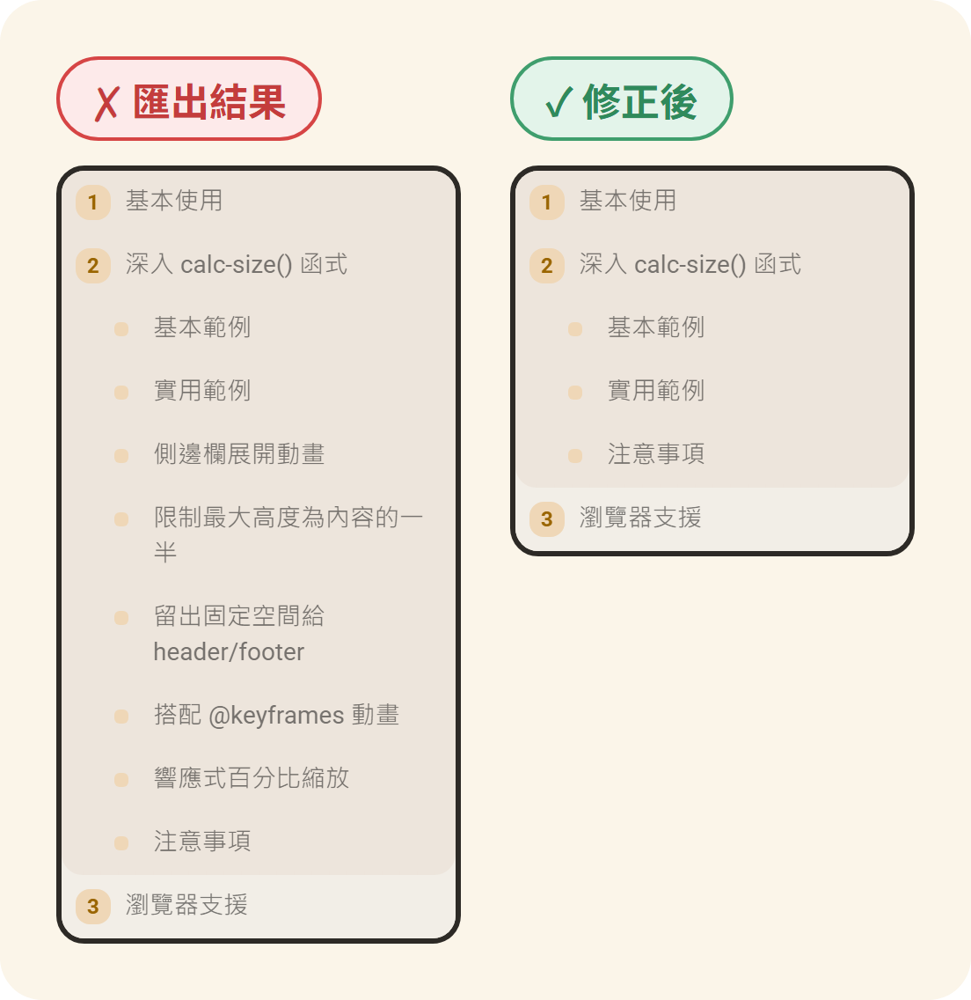

## 🔍 前言

之前的技術筆記都寫在 Notion，架好部落格後想說匯出 Markdown 丟進來就好

實際搬了三篇才發現沒那麼簡單：從解壓縮就開始出狀況，而且 **大部分的問題建置都不會報錯**，要打開頁面才看得出來

就像冰山一樣，看得到的只有一小角 🧊


這篇把踩到的坑整理起來，下次搬文章照著檢查就好

---

## 📋 一張表看完 12 個坑

| # | 坑 | 什麼時候會發現 | 嚴重度 |
| --- | --- | --- | --- |
| 1 | 解壓縮後中文檔名變亂碼 | 解壓縮當下 | 🟡 |
| 2 | 檔名帶著 Notion ID | 看網址才發現 | 🟢 |
| 3 | 沒有 frontmatter | ✅ 建置直接報錯 | 🔴 |
| 4 | 沒有原始發文日期 | 要自己想到 | 🟢 |
| 5 | 引言後面多一行空的 `>` | 看原始檔 | 🟢 |
| 6 | 程式碼裡的網址被包 `< >` | ⚠️ 讀者複製時 | 🔴 |
| 7 | JavaScript 被標成 `jsx` | 看原始檔 | 🟢 |
| 8 | 粗體沒閉合，星號露出來 | ⚠️ 打開頁面 | 🟡 |
| 9 | 標題層級被壓平 | ⚠️ 看目錄 | 🟢 |
| 10 | 圖片外連、沒有替代文字 | ⚠️ 圖片壞掉那天 | 🟡 |
| 11 | 連結失效、佔位字串 | ⚠️ 點下去才知道 | 🔴 |
| 12 | 檔案結尾沒有換行 | 看 git diff | 🟢 |

> [!TIP]
> 🔴 讀者會直接遇到　🟡 影響閱讀　🟢 小問題，順手修掉就好

---

## 🗺️ 搬家流程



第 5 步最容易偷懶，但也最重要：**`pnpm build` 能過不代表畫面是對的**

---

## 📦 解壓縮與檔名

### 1. 解壓縮後中文檔名變亂碼

**🐛 症狀**：用 Git Bash 內建的 `unzip` 解開匯出檔，中文檔名全變成亂碼



**🔍 原因**：zip 裡其實有標記檔名是 UTF-8，是 `unzip` 在 Windows 上沒處理好

**🔧 解法**：改用 Python 的 `zipfile`。下面這段連「沒有標記 UTF-8」的 zip 都能正確解出中文檔名：

```python title="unzip_notion.py" {11-13}
import os
import sys
import zipfile

src, dst = sys.argv[1], sys.argv[2]

with zipfile.ZipFile(src) as z:
    for info in z.infolist():
        name = info.filename

        # 沒有 UTF-8 標記時，Python 會用 cp437 解碼，要轉回來
        if not info.flag_bits & 0x800:
            name = name.encode("cp437").decode("utf-8")

        out = os.path.join(dst, name)
        os.makedirs(os.path.dirname(out) or dst, exist_ok=True)
        if not name.endswith("/"):
            with open(out, "wb") as f:
                f.write(z.read(info))
```

```bash
python unzip_notion.py article-1.zip out
```

### 2. 檔名帶著 Notion 的 32 碼 ID

**🐛 症狀**：檔名最後多了一串頁面 ID，Astro 會直接拿檔名當網址

```text
CSS interpolate-size 與 calc-size() 完全指南 344f3cdd5bae805ba458fcdf27308d70.md
```

**🔧 解法**：改成英文 slug（小寫、用 `-` 連接），例如 `css-interpolate-size-calc-size.md`

---

## 🏷️ Frontmatter

### 3. 沒有 frontmatter，標題是內文的 H1

**🐛 症狀**：匯出檔只有一行 `# 標題`，建置直接失敗

**🔍 原因**：部落格規定 `title`、`published` 必填，Notion 匯出卻完全沒有 frontmatter

**🔧 解法**：補上 frontmatter，**並刪掉 `# H1`**。文章頁會自己用 `title` 顯示標題，不刪的話標題會出現兩次

```yaml title="frontmatter"
---
title: "文章標題"
published: 2026-11-19
description: 一兩句摘要，會顯示在文章列表和 SEO description
tags: [CSS, 動畫]
category: 前端開發
draft: false
---
```

> [!TIP]
> 標題裡有 `:`、`?`、`#` 這類符號時用雙引號包起來，避免 YAML 解析錯誤

### 4. 匯出檔裡沒有原始發文日期

**🐛 症狀**：Markdown 裡找不到建立或編輯時間，zip 的時間戳記也只是匯出當下

**🔧 解法**：想保留原本的日期，只能回 Notion 一篇一篇查

---

## ✍️ 內文格式

### 5. 引言後面多一行空的 `>`

**🐛 症狀**：每個 callout 或引言後面，都多一行只有 `>` 的空行

```markdown del={2}
> `interpolate-size` 是**可繼承的**，所以設在 `:root` 上，所有子元素都會生效。
>
```

**🔧 解法**：刪掉就好。順便把 Notion 的 callout 改成主題支援的提示框，重點會清楚很多：

```markdown ins={1}
> [!NOTE]
> `interpolate-size` 是**可繼承的**，所以設在 `:root` 上，所有子元素都會生效。
```



提示框有 `[!NOTE]`、`[!TIP]`、`[!IMPORTANT]`、`[!WARNING]`、`[!CAUTION]` 五種，依內容挑選

### 6. 程式碼區塊裡的網址被加上角括號

這是最容易漏掉的一個 ⚠️

**🐛 症狀**：程式碼裡的網址被包成 `<https://...>`，讀者複製下來直接壞掉

```html del={1} ins={2}
<script src="<https://cdn.jsdelivr.net/npm/leader-line-new@1.1.9/leader-line.min.js>"></script>
<script src="https://cdn.jsdelivr.net/npm/leader-line-new@1.1.9/leader-line.min.js"></script>
```

**🔍 原因**：Notion 會自動把網址轉成連結，連程式碼區塊裡的字串也不放過

**🔧 解法**：全文搜尋 `<https`，把角括號拿掉

> [!WARNING]
> 建置不會報錯，畫面上看起來也只是多兩個符號，很容易就這樣發出去了

### 7. JavaScript 被標成 `jsx`

**🐛 症狀**：在 Notion 選「JavaScript」，匯出後程式碼區塊會標成 ` ```jsx `

**🔧 解法**：語法上色不會出錯，但標示不正確。一般的 JS 改成 ` ```js `，真的是 React 才保留 `jsx`

### 8. 換行消失，粗體沒有閉合

**🐛 症狀**：段落裡直接露出 `**` 兩個星號



**🔍 原因**：Notion 區塊裡用 Shift + Enter 換的行匯出後不見了，前後兩段黏在一起，原本的粗體也跟著壞掉

```markdown del={1} ins={2-4}
Figma 插件 - Chromatic Figma **推薦使用方式非常簡單，對想要轉換漸層顏色的物件點選插件...
Figma 插件 - Chromatic Figma **推薦**

使用方式非常簡單，對想要轉換漸層顏色的物件點選插件...
```

**🔧 解法**：搜尋落單的 `**` 補回閉合，或是直接打開頁面找有沒有星號

### 9. 標題層級被壓平

**🐛 症狀**：右側目錄所有小標都排在同一層，又長又看不出結構



**🔍 原因**：Notion 只有 H1 到 H3，原本是第四層的小標匯出後也是 `###`

**🔧 解法**：依內容判斷，把子項目改成 `####`。這個主題的目錄只顯示到第三層，改完後細項會收起來，目錄也跟著變乾淨

---

## 🔗 圖片與連結

### 10. 圖片沒有替代文字，還放在外部主機

**🐛 症狀**：匯出的圖片都是 ``，沒有替代文字（alt）

**🔍 原因**：在 Notion 裡如果是「貼網址」而不是上傳圖片，zip 裡就不會有圖檔，文章會直接連到外部主機

**🔧 解法**：

- 補上替代文字，描述圖片在呈現什麼，螢幕閱讀器和圖片載入失敗時都用得到
- 重要的圖片下載到專案裡，對方主機搬家或擋外部引用時才不會全部壞掉

### 11. 失效的連結和沒換掉的佔位字串

**🐛 症狀**：這次遇到三種

- **連到 Notion 的連結**：被轉成 `https://app.notion.com/p/...`，讀者沒有權限打不開
- **佔位字串**：原稿寫了 `{CODEPEN_URL}` 打算之後補，匯出後變成指向 Notion 的壞連結
- **連結本身就是錯的**：套件的 GitHub 連結是 404，原稿就寫錯了

**🔧 解法**：全文搜尋 `notion.com`、`{`、`TODO`，外部連結逐一點過。npm 套件的正確 repo 可以直接問 npm registry：

```bash
curl -s https://registry.npmjs.org/leader-line-new | python -c "import json,sys; print(json.load(sys.stdin)['repository'])"
```

查到正確的 repo 之後，還可以用主題內建的 GitHub 卡片語法，讀者一眼就看得到套件資訊：

::github{repo="II-alex-II/leader-line-new"}

暫時補不到的段落，可以先用 HTML 註解 `<!-- -->` 包起來，畫面上不會顯示

> [!CAUTION]
> HTML 註解還是會留在網頁原始碼裡，打開「檢視原始碼」看得到，不要在裡面寫不想公開的內容

### 12. 檔案結尾沒有換行

**🐛 症狀**：git diff 出現 `\ No newline at end of file`

**🔧 解法**：在檔案最後補一個換行

---

## 🧪 一行指令檢查常見問題

轉換完後在 `src/content/posts/` 下執行：

```bash
grep -nE '^> ?$|<https?://|```jsx|notion\.com|\{[A-Z_]+\}|TODO|!\[\]' *.md
```

| 規則 | 抓的是 |
| --- | --- |
| `^> ?$` | 坑 5：空的引言行 |
| `<https?://` | 坑 6：被包住的網址 |
| ` ```jsx ` | 坑 7：`jsx` 標記 |
| `notion\.com`、`\{[A-Z_]+\}`、`TODO` | 坑 11：Notion 連結、佔位字串 |
| `!\[\]` | 坑 10：沒有替代文字的圖片 |

沒有輸出，就代表這幾項都處理完了 🎉

---

## 🏆 結論

Notion 匯出的 Markdown 大致上能用，麻煩的是 **很多錯誤建置不會報錯**

程式碼裡的角括號、露出來的星號、壞掉的連結，都要打開頁面才看得出來。所以搬家時除了 `pnpm build` 要過，一定要再用 `pnpm dev` 把每篇文章實際看過一次 ✅
